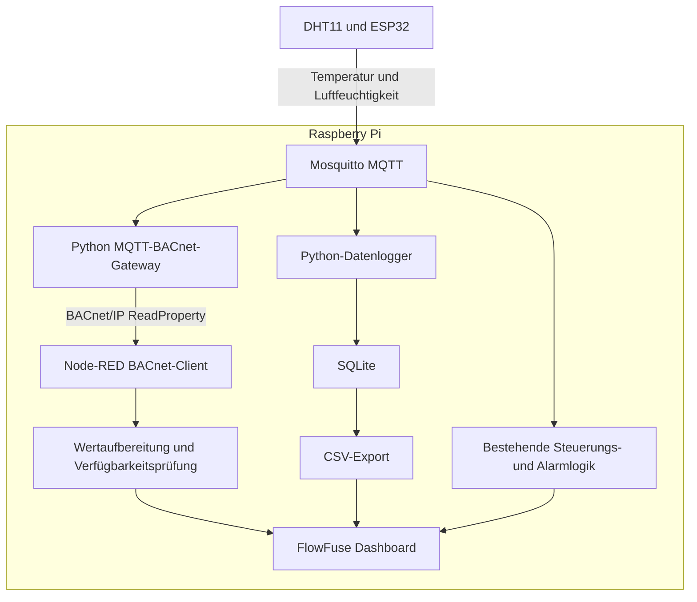

# BMS MQTT–BACnet/IP Integration

### Gebäudeautomation im Labor: reale Sensorik, Protokollintegration und nachvollziehbare Fehlerbehandlung

**ESP32 · Raspberry Pi · MQTT · BACnet/IP · Node-RED · Python · SQLite**

🇩🇪 [Deutsch](#deutsch) | 🇬🇧 [English](#english)

---

<a id="deutsch"></a>

## Projektübersicht

Dieses persönliche Gebäudeautomationsprojekt erweitert einen bestehenden Raumautomationsaufbau um eine **MQTT–BACnet/IP-Schnittstelle**, historische Messdatenspeicherung und eine überwachte BACnet-Anbindung im Dashboard.

Ein ESP32 erfasst Temperatur und relative Luftfeuchtigkeit mit einem DHT11 und veröffentlicht die Messwerte über MQTT. Eine Python-Anwendung auf dem Raspberry Pi übernimmt diese Werte und stellt sie als BACnet-Objekte bereit.

Node-RED liest die BACnet-Datenpunkte zyklisch aus und zeigt sowohl die Messwerte als auch deren Verfügbarkeit an. Bei fehlenden Sensordaten oder einer nicht erreichbaren BACnet-Anwendung werden die betroffenen BACnet-Anzeigen durch **„Daten nicht verfügbar“** ersetzt.

Ergänzend speichert ein separater Python-Datenlogger die MQTT-Messwerte in SQLite. Die gespeicherten Daten können über das Dashboard als CSV heruntergeladen werden.

**Ziel:** Den vollständigen Weg vom realen Sensor über eine Protokollschnittstelle bis zur Visualisierung verstehen, umsetzen und unter gezielt erzeugten Fehlerbedingungen prüfen.

> Persönlicher Labor- und Lernaufbau für einen Raum. Der BACnet-Server ist eine Softwareimplementierung und kein industrieller DDC-Controller.

## Ausgangsprojekt und Weiterentwicklung

Dieses Projekt baut auf folgendem Projekt auf:

**[BMS-ESP32-MQTT-HVAC](https://github.com/ahmad-energy-iot/BMS-ESP32-MQTT-HVAC)**

Der Ausgangsaufbau umfasst reale Sensorik und Lüfteransteuerung, MQTT-Kommunikation, einen Modbus-TCP-Simulator, Hystereseregelung, Betriebsarten, Alarmhistorie und eine Energieabschätzung.

Die Erweiterung ergänzt insbesondere:

| Bereich | Erweiterung |
|---|---|
| Protokollintegration | Python-Gateway von MQTT zu BACnet/IP |
| BACnet-Datenmodell | Zwei Analog-Value-Objekte für Temperatur und Luftfeuchtigkeit |
| Datenpunktprüfung | Lesen von Wert, Name, Einheit und Verfügbarkeitskennzeichen |
| Geräteidentifikation | Gerichtete Who-Is-Abfrage und Auslesen der Object List |
| Visualisierung | BACnet-Abfragen aus Node-RED im 5-Sekunden-Intervall |
| Datenverfügbarkeit | Unabhängige Aktualisierungsüberwachung je Messgröße |
| Kommunikationsfehler | Catch-basierte Behandlung von BACnet-Lesefehlern |
| Messdatenhistorie | Python-Datenlogger mit SQLite und SQL-Auswertungen |
| Datenexport | CSV-Download über das Dashboard |
| Alarmierung | Getrennte Ereignisse für Temperaturdatenausfall und fehlende simulierte Lüfterrückmeldung |
| Betrieb | Datenlogger und BACnet-Gateway als systemd-Dienste |

## Architektur



Die bestehenden MQTT-Steuerungsfunktionen bleiben erhalten.

**Das BACnet-Gateway stellt Messwerte bereit. Die Lüfterregelung wurde nicht auf BACnet übertragen.**

Die direkte MQTT-Anzeige und die BACnet-Anzeige verwenden dieselbe physische Sensorquelle. Es handelt sich nicht um zwei unabhängige Messsysteme.

## Hardware und Software

| Bestandteil | Aufgabe |
|---|---|
| ESP32 mit MicroPython | Sensorabfrage, MQTT-Veröffentlichung und Ausgangsansteuerung im bestehenden BMS |
| DHT11 | Reale Temperatur- und Luftfeuchtemessung |
| Raspberry Pi | Plattform für Broker, Node-RED und Python-Anwendungen |
| Mosquitto | MQTT-Broker |
| Python / BACpypes3 | Bereitstellung der BACnet/IP-Geräte- und Datenpunktstruktur |
| paho-mqtt | MQTT-Empfang in den Python-Anwendungen |
| Node-RED | Integration, bestehende Steuerungslogik und Fehlerbehandlung |
| FlowFuse Dashboard | Visualisierung, Bedienung und CSV-Download |
| SQLite | Lokale Speicherung der Messdaten |
| systemd | Hintergrundbetrieb der Python-Dienste |
| Relais und 5-V-Lüfter | Reale Aktoransteuerung im bestehenden Aufbau |
| LED | Darstellung eines Kühlventils |
| Modbus-TCP-Simulator | Bestehende Sollwert-, Befehls- und Rückmeldungsintegration |

### Verwendete Versionen im Labor

| Komponente | Version / Umgebung |
|---|---|
| Betriebssystem | Debian GNU/Linux 13, ARM64 |
| Python | 3.13.5 |
| BACpypes3 | 0.0.110 |
| paho-mqtt | 2.1.0 |
| FlowFuse Dashboard | 1.32.0 |
| node-red-contrib-bacnet | 0.3.0 |

Die Angaben dokumentieren die verwendete Testumgebung und sind keine allgemeine Kompatibilitätszusage für andere Versionen.

## BACnet/IP-Datenpunkte

Das Gateway stellt ein Softwaregerät mit folgender Identität bereit:

| Eigenschaft | Wert |
|---|---|
| Device Instance | `123001` |
| Device Name | `BMS-Room1-Bridge` |
| BACnet/IP-Serverport | UDP `47808` |

### Datenpunktliste

| Messgröße | MQTT-Topic | BACnet Object Identifier | Object Name | Einheit |
|---|---|---|---|---|
| Temperatur | `bms/room1/temperature` | `analog-value,1` | `Room1_Temperature` | `degrees-celsius` |
| Relative Luftfeuchtigkeit | `bms/room1/humidity` | `analog-value,2` | `Room1_Humidity` | `percent-relative-humidity` |

Die Analog-Value-Objekte repräsentieren Softwarewerte aus MQTT. Sie sind keine physischen Analogeingänge eines industriellen BACnet-Controllers.

### Gelesene Eigenschaften

- `present-value`: aktueller, im Gateway gespeicherter Wert.
- `object-name`: Name des Datenpunkts.
- `units`: technische Einheit.
- `out-of-service`: im Labor verwendetes Kennzeichen für nicht verfügbare Gateway-Daten.
- `object-list` am Device Object: Liste der bereitgestellten Objekte.

**Device Instance und Object Instance sind unterschiedliche Kennungen.**

Beispiel: `123001` identifiziert das Gerät. `analog-value,1` identifiziert das Temperatur-Object innerhalb dieses Geräts.

## MQTT–BACnet-Gateway

Das Gateway:

1. verbindet sich mit dem lokalen MQTT-Broker,
2. abonniert die beiden Messwerttopics,
3. prüft eingehende Werte,
4. aktualisiert die jeweilige BACnet-Eigenschaft,
5. überwacht den Zeitpunkt der letzten gültigen Aktualisierung.

### Validierung und Aktualisierung

- Nicht numerische und nicht endliche Werte werden verworfen.
- Luftfeuchtigkeit muss zwischen `0` und `100` liegen.
- Retained-Nachrichten werden nicht als neue Sensormessungen übernommen.
- Temperatur und Luftfeuchtigkeit werden unabhängig voneinander überwacht.
- MQTT-Callbacks übergeben Aktualisierungen mittels `loop.call_soon_threadsafe()` an die asyncio-Ereignisschleife.

Eine MQTT-Nachricht aktualisiert den Gateway-Wert. Der BACnet-Client kann diesen Wert anschließend mit `ReadProperty` abfragen.

### Überwachung fehlender Messwerte

Die konfigurierte Aktualisierungsfrist beträgt **15 Sekunden je Messgröße**.

Ohne neue gültige Messung wird die betreffende Punktverfügbarkeit umgeschaltet. Nach Eingang einer neuen gültigen Messung wird sie automatisch zurückgesetzt.

Der letzte Zahlenwert bleibt intern erhalten. Beim Start ist der Initialwert `0.0` ein Platzhalter und keine Sensormessung.

> **Bewusste Laborvereinfachung:** Das Gateway verwendet `Out_Of_Service` und das entsprechende Status-Flag zur Darstellung fehlender Quelldaten. Daraus folgt nicht, dass `Out_Of_Service` bei beliebigen BACnet-Geräten allgemein einen Kommunikationsausfall bezeichnet. Für eine produktive Integration wäre ein zum Gerät und zur Anwendung passendes Qualitätsmodell, beispielsweise unter Einbeziehung von Reliability, festzulegen.

Die Überwachung erfolgt zyklisch; die Reaktion ist keine garantierte Echtzeitauslösung exakt nach 15 Sekunden.

## BACnet-Integration in Node-RED

Node-RED arbeitet als BACnet-Client und fragt vier Eigenschaften zyklisch ab:

| Leseknoten | Object Type | Object Instance | Property ID | Bedeutung |
|---|---:|---:|---:|---|
| `Room1 Temperature` | 2 | 1 | 85 | Temperaturwert |
| `Room1 Humidity` | 2 | 2 | 85 | Luftfeuchtewert |
| `Room1 Temperature OOS` | 2 | 1 | 81 | Verfügbarkeitskennzeichen Temperatur |
| `Room1 Humidity OOS` | 2 | 2 | 81 | Verfügbarkeitskennzeichen Luftfeuchtigkeit |

- Object Type `2`: Analog Value.
- Property `85`: Present Value.
- Property `81`: Out Of Service.
- Abfrageintervall: **5 Sekunden**.
- Konfigurierter APDU-Timeout im Node-RED-Client: **6000 ms**.

Die aktuelle Visualisierung verwendet **Polling, keine COV-Subscription**.

### Aufbereitung der Antworten

Die Funktionen `BACnet Temperature Value` und `BACnet Humidity Value` lesen den Wert aus:

```javascript
msg.payload.values[0].value
```

Nach Prüfung wird der Messwert als numerischer `msg.payload` an die Anzeigeaufbereitung weitergegeben.

### Verfügbarkeitsabhängige Anzeige

Die Funktionen:

- `Temp Anzeige Guard`
- `Humidity Anzeige Guard`

führen Wert und OOS-Zustand für die jeweilige Messgröße zusammen.

| Zustand | BACnet-Messwertanzeige |
|---|---|
| Wert gültig und Punkt verfügbar | Zahlenwert |
| Punkt als nicht verfügbar gemeldet | `Daten nicht verfügbar` |
| Noch kein gültiger Verfügbarkeitszustand bekannt | Keine Freigabe eines Zahlenwerts |

Bei Rückkehr der Verfügbarkeit wird die nächste gültige Wertantwort angezeigt.

Es wird ausdrücklich ein Ersatztext gesendet. Ein bloßes `return null` würde die alte Anzeige unverändert lassen.

### Kommunikationsfehler

Wenn der BACnet-Dienst nicht antwortet, kann auch dessen OOS-Eigenschaft nicht gelesen werden.

Deshalb überwacht `BACnet Fehler Catch` die BACnet-Leseknoten. Die Funktion `BACnet Fehler Anzeige` ordnet den Fehler anhand des Quellknotens der Temperatur oder Luftfeuchtigkeit zu.

Bei einem Lesefehler werden die betroffenen Anzeigen ebenfalls auf **„Daten nicht verfügbar“** gesetzt.

Die intern erzeugte Meldung ist eine Anzeigeinformation von Node-RED und keine empfangene BACnet-Antwort des ausgefallenen Geräts.

Die aktuelle Fehlerzuordnung verwendet Knotennamen. Änderungen dieser Namen erfordern eine entsprechende Anpassung der Zuordnung.

## SQLite-Messdatenhistorie

Ein separater Python-Datenlogger empfängt die MQTT-Messwerte und speichert sie in:

```text
bms.db
```

Temperatur und Luftfeuchtigkeit kommen als getrennte MQTT-Nachrichten an und werden deshalb als getrennte Datensätze gespeichert.

| Spalte | Inhalt |
|---|---|
| `id` | Datensatzkennung |
| `received_at` | Empfangszeitpunkt auf dem Raspberry Pi |
| `room` | Raumkennung |
| `metric` | Messgröße |
| `value` | Numerischer Messwert |
| `unit` | Einheit |

### Speicherintervall und Aufbewahrung

- Mindestens **60 Sekunden zwischen zwei gespeicherten Werten derselben Messgröße** innerhalb eines laufenden Logger-Prozesses.
- Speicherung der ersten geeigneten Nachricht nach Ablauf dieses Intervalls.
- Löschung von Datensätzen, deren Empfangszeit mehr als **72 Stunden** zurückliegt.
- Bereinigung beim Programmstart und während des laufenden Empfangs.
- Kein Hintergrundlöschen bei gestopptem Datenlogger.
- Keine nachträgliche Rekonstruktion von Messungen, die während eines Ausfalls nicht empfangen wurden.

Ein Neustart des Loggers setzt die im Arbeitsspeicher gehaltene Intervallverwaltung zurück.

Gelöschter Speicherplatz kann von SQLite wiederverwendet werden; die Dateigröße muss dadurch nicht unmittelbar sinken.

### SQL-Auswertungen

Praktisch verwendet wurden:

- Anzahl gespeicherter Messungen.
- Anzeige der letzten Datensätze.
- Durchschnitt, Minimum und Maximum.
- Getrennte Auswertung nach Messgröße mit `GROUP BY`.

Die berechneten Mittelwerte beziehen sich auf gespeicherte Stichproben und sind keine automatisch zeitgewichteten Mittelwerte.

## CSV-Export

Das Dashboard bietet einen Button **„CSV herunterladen“**.

Der Export enthält die zum Exportzeitpunkt in SQLite verfügbaren Temperatur- und Luftfeuchtedatensätze:

```text
id;received_at;room;metric;value;unit
```

- Semikolon als Trennzeichen.
- UTF-8 mit BOM zur Unterstützung der Darstellung in Tabellenprogrammen.
- Download im Browser.
- Verarbeitung als Exportdatei ohne Änderung der Quelldaten.
- Anforderungskennung zur Zuordnung des Downloads zu einer neuen Betätigung des Buttons.

Nach einer Korrektur der Downloadlogik wurde geprüft, dass ein Deploy keinen erneuten automatischen Download auslöst und eine neue Betätigung einen Download anstößt.

Der CSV-Export umfasst Messwerte, nicht die separate Alarmhistorie oder Lüfterzustände.

## Erweiterte Alarmierung

Neben der BACnet-Anzeige wurde die bestehende Alarmverarbeitung erweitert.

### Getrennte Alarmursachen

- Fehlende Temperaturdaten.
- Lüfterbefehl `ON` ohne simulierte Rückmeldung nach Ablauf der Überwachungsverzögerung.

Beide Ursachen können gleichzeitig aktiv sein. Die Alarmhistorie führt dafür getrennte Ereignisse mit:

- Beginn,
- Ende,
- Status `AKTIV` oder `GEGANGEN`,
- ursachenspezifischer Meldung.

Aktive Ereignisse werden bevorzugt berücksichtigt; die Anzeige bleibt auf drei Einträge begrenzt.

Die Lüfterrückmeldung bleibt simuliert. Ein Lüfterbefehl und eine simulierte Rückmeldung sind kein Nachweis einer gemessenen mechanischen Drehung.

## Betrieb als systemd-Dienste

| Dienst | Aufgabe |
|---|---|
| `bms-logger.service` | MQTT-Messwerte in SQLite speichern |
| `bms-bacnet.service` | MQTT-Messwerte über BACnet/IP bereitstellen |

Die BACnet-Serviceversion liest MQTT-Zugangsdaten aus einer lokalen JSON-Konfiguration außerhalb des Programmquelltexts.

Die Dienste wurden im laufenden Betrieb geprüft. Für den BACnet-Dienst wurden auch Stoppen, Starten und anschließende BACnet-Lesezugriffe getestet.

**Aktivierter Autostart ist nicht mit einem durchgeführten Neustarttest gleichzusetzen:** Ein vollständiger Reboot-Test des Raspberry Pi bleibt ausstehend.

### Ports im getesteten Aufbau

| Anwendung | Port |
|---|---:|
| MQTT-Broker | TCP 1883 |
| BACnet-Gateway | UDP 47808 |
| BACpypes3-Testclient | UDP 47809 |
| Node-RED-BACnet-Client | UDP 47810 |

Gateway und Clients liefen auf demselben Raspberry Pi. Separate lokale BACnet-Ports vermeiden Portkonflikte.

## Praktisch getestete Szenarien

| Szenario | Beobachtetes Ergebnis |
|---|---|
| Erste BACnet-Verbindung mit festem Testwert | Wert, Name und Einheit erfolgreich gelesen |
| Reale MQTT-Temperatur über BACnet lesen | Sensorwert im BACnet-Client verfügbar |
| Reale Luftfeuchtigkeit über BACnet lesen | Wert, Einheit und Object Name verfügbar |
| Gerichtete Who-Is-Abfrage | Antwort mit Device Instance und Adresse |
| Object List lesen | Device, Network Port und beide Analog Values sichtbar |
| ESP32 unterbrechen und wieder anschließen | Gateway-Verfügbarkeit ändert sich und erholt sich nach neuen Messungen |
| Nur Luftfeuchteaktualisierung nach erfolgreichem Empfang pausieren | Luftfeuchtigkeit wird nicht verfügbar; Temperatur bleibt verfügbar |
| Luftfeuchteaktualisierung fortsetzen | Automatische Erholung ohne Neustart der Testanwendung |
| BACnet-Messwerte in Node-RED lesen | Werte erfolgreich extrahiert und im Dashboard angezeigt |
| Sensordaten unterbrechen | Betroffene BACnet-Zahlenanzeigen werden durch Ersatztext ersetzt |
| BACnet-Dienst stoppen | `ERR_TIMEOUT` wird erfasst; Anzeigen melden Nichtverfügbarkeit |
| BACnet-Dienst starten | Zahlenwerte und Status kehren zurück |
| MQTT-Broker unterbrechen und starten | Datenlogger speichert anschließend wieder neue Messwerte |
| SQLite-Daten lesen | Gespeicherte Datensätze und SQL-Zusammenfassungen verfügbar |
| Aufbewahrungsbedingung prüfen | Datumsbasierte Löschbedingung in temporärer Testdatenbank geprüft |
| CSV-Download | Export im Browser heruntergeladen und in einem Tabellenprogramm geöffnet |
| CSV nach Deploy | Ungewollter automatischer erneuter Download durch Anpassung behoben |

Der MQTT-Wiederanlauftest bestätigt die Rückkehr neuer gespeicherter Messwerte. Er unterscheidet nicht abschließend zwischen Wiederverbindung innerhalb des Prozesses und einem Neustart durch systemd.

Die Aufbewahrungsbedingung wurde in einer temporären Datenbank getestet; dies ersetzt keine mehrtägige Dauerbeobachtung der Bereinigung.

## Real, simuliert und geschätzt

| Bestandteil | Umsetzung |
|---|---|
| Temperatur und Luftfeuchtigkeit | Reale DHT11-Messwerte |
| MQTT- und BACnet-Kommunikation | Tatsächliche Protokollkommunikation im Labor |
| BACnet-Gerät | Python-Softwaregerät auf dem Raspberry Pi |
| Industrieller BACnet-DDC-Controller | Nicht verwendet |
| Lüfter | Reales 5-V-Gerät im bestehenden BMS |
| Lüfterrückmeldung | Simuliert |
| Kühlventil | Durch LED dargestellt |
| Modbus-Automationsstation | Simulator in Node-RED |
| Lüfterlaufzeitanzeige | Dauer des ON-Befehls |
| Energieanzeige | Abschätzung mit angenommener Leistung von 2 W |

## Einrichtung und Reproduzierbarkeit

Die Implementierung besteht aus ESP32-Firmware, Node-RED-Flow, Python-Anwendungen, Python-Abhängigkeiten und systemd-Konfigurationen.

Für die Einrichtung sind insbesondere erforderlich:

1. Raspberry Pi mit Python, Node-RED und Mosquitto vorbereiten.
2. Die im Flow verwendeten Dashboard-, Modbus-, SQLite- und BACnet-Pakete installieren.
3. Die benötigten Python-Umgebungen und Abhängigkeiten einrichten.
4. MQTT-Broker und Zugangsdaten lokal konfigurieren.
5. SQLite-Tabelle mit dem Initialisierungsskript anlegen.
6. Netzwerkadressen und BACnet-Ports für die eigene Umgebung anpassen.
7. Eindeutige Device Instances und MQTT Client IDs verwenden.
8. Den benannten Node-RED-Kontextspeicher `file` für persistente Alarm- und Zählerdaten konfigurieren.
9. Den zu dieser Projektversion gehörenden Flow importieren.
10. Dienstdateien an Benutzer, Pfade und Netzwerkumgebung anpassen.
11. Dienste starten und Messwerte, Verfügbarkeit und Fehlerreaktionen prüfen.

Die lokale Testadresse war `192.168.178.38/24`. Sie ist kein allgemeiner Standardwert.

Lokale Zugangsdaten, laufende Datenbanken und gespeicherte Kontextwerte sind keine Voraussetzung für die Veröffentlichung des Quellcodes. Eine vollständige Wiederherstellung auf einem frisch installierten System wurde noch nicht getestet.

## Grenzen und offener Ausbau

- Laboraufbau für einen Raum.
- Kein BTL-zertifiziertes BACnet-Produkt.
- Keine zertifizierte Sicherheitssteuerung.
- Kein Test mit einem industriellen DDC-Controller.
- Keine Inbetriebnahme in einem produktiven Gebäude.
- BACnet-Integration derzeit zum Lesen und Überwachen.
- Keine implementierte BACnet-Sollwertschreibung oder Priority-Array-Steuerung.
- Keine getestete COV-Subscription.
- Keine erprobte BACnet-MS/TP-, BBMD- oder BACnet/SC-Integration.
- Reboot- und vollständiger Wiederherstellungstest ausstehend.
- Verfügbarkeit wird durch das projektspezifische OOS-Modell dargestellt.
- Abfrage-, Überwachungs- und Netzwerkzeiten sind keine garantierten Echtzeitfristen.

In einer separaten COV-Testversion wurde `covIncrement` konfiguriert und gelesen. Eine erfolgreiche Benachrichtigungsübertragung wurde nicht nachgewiesen; die aktive Dashboard-Anbindung verwendet Polling.

## Erarbeitete Kenntnisse

- Ein bestehendes Gebäudeautomationsprojekt um eine weitere Protokollschnittstelle erweitern.
- MQTT-Topics auf BACnet-Objekte abbilden.
- Device, Object und Property unterscheiden.
- Geräteidentität und Objektlisten lesen.
- BACnet-Messwerte und Zustandsinformationen integrieren.
- Fehlende Quelldaten von einer nicht antwortenden Gateway-Anwendung unterscheiden.
- Veraltete Zahlenanzeigen bei erkannten Fehlern durch eindeutige Zustände ersetzen.
- Zeitreihendaten in SQLite speichern und mit SQL auswerten.
- Messwerte als CSV bereitstellen.
- Python-Anwendungen als Linux-Dienste betreiben.
- Tests, reale Komponenten, Simulationen und offene Punkte nachvollziehbar dokumentieren.

---

<a id="english"></a>

## Project Overview

This personal building automation laboratory extends an existing room automation project with a **MQTT-to-BACnet/IP gateway**, historical measurement storage and monitored BACnet dashboard integration.

An ESP32 measures temperature and relative humidity using a DHT11 and publishes the readings over MQTT. A Python application on a Raspberry Pi maps these measurements to BACnet objects.

Node-RED polls the BACnet properties and displays both values and availability information. When sensor updates are missing or the BACnet application cannot be reached, the affected BACnet measurement displays show **“Daten nicht verfügbar”** instead of retaining an apparently current number.

A separate Python logger stores MQTT measurements in SQLite. Stored readings can be downloaded as CSV through the dashboard.

**Purpose:** Implement and understand the path from a physical sensor through a protocol gateway to a supervisory interface, including deliberately introduced failure conditions.

### Previous Project

This project builds on:

**[BMS-ESP32-MQTT-HVAC](https://github.com/ahmad-energy-iot/BMS-ESP32-MQTT-HVAC)**

The original setup provides physical sensor readings and fan switching, MQTT communication, Modbus TCP simulation, hysteresis control, operating modes, alarm history and an energy estimate.

### Main Extensions

- MQTT-to-BACnet/IP integration using Python and BACpypes3.
- Two Analog Value objects for real temperature and humidity readings.
- Directed device discovery and Object List inspection.
- BACnet polling from Node-RED every five seconds.
- Independent update monitoring for each measurement.
- Availability-dependent dashboard displays.
- Catch-based handling of BACnet read failures.
- SQLite measurement storage and SQL summaries.
- Browser-based CSV download.
- Separate alarm records for missing temperature data and missing simulated fan feedback.
- Background operation through systemd.

## System Roles

| Component | Role |
|---|---|
| DHT11 | Physical temperature and humidity sensor |
| ESP32 | Sensor acquisition and MQTT publishing; output control in the existing BMS |
| Mosquitto | MQTT broker |
| Python gateway | Exposes MQTT measurements as BACnet/IP objects |
| Node-RED | Existing control logic, BACnet client, integration and error handling |
| FlowFuse Dashboard | Supervisory display and operation |
| Python logger / SQLite | Historical measurement storage |
| systemd | Background service management |

**The BACnet gateway does not perform the existing fan control logic.** Control remains in Node-RED.

The MQTT and BACnet displays use the same physical sensor source. They are not independent measurement channels.

## BACnet Data Model

| Item | Configuration |
|---|---|
| Device Instance | `123001` |
| Device Name | `BMS-Room1-Bridge` |
| Temperature | `analog-value,1` / `Room1_Temperature` |
| Humidity | `analog-value,2` / `Room1_Humidity` |
| Temperature units | `degrees-celsius` |
| Humidity units | `percent-relative-humidity` |

The Analog Value objects represent software values received through MQTT, not physical analog inputs of an industrial BACnet controller.

Properties read during testing include:

- `present-value`
- `object-name`
- `units`
- `out-of-service`
- Device `object-list`

The software device was successfully identified using a directed Who-Is request.

### Example Read Requests

Run these inside the BACpypes3 client shell:

```text
whois 192.168.178.38
read 192.168.178.38 device,123001 object-list
read 192.168.178.38 analog-value,1 present-value
read 192.168.178.38 analog-value,1 out-of-service
read 192.168.178.38 analog-value,2 present-value
read 192.168.178.38 analog-value,2 out-of-service
```

The address is specific to the laboratory network and must be adapted elsewhere.

## Data Validation and Availability

The gateway rejects invalid numeric values and requires humidity to be within `0–100%`. Retained MQTT messages are not treated as new sensor samples.

Each measurement has an independent **15-second update timeout**.

The last numeric value remains stored internally. Initial zero values are placeholders, not sensor readings.

> **Laboratory design choice:** `Out_Of_Service` and its corresponding status flag are used as a project-specific indicator of unavailable gateway source data. This must not be generalized to the meaning of OOS on arbitrary BACnet devices. A production integration would require a suitable device and application quality model.

No separate Reliability evaluation was implemented.

## Node-RED Monitoring

| Read node | Type | Instance | Property ID |
|---|---:|---:|---:|
| Temperature value | 2 | 1 | 85 |
| Humidity value | 2 | 2 | 85 |
| Temperature OOS | 2 | 1 | 81 |
| Humidity OOS | 2 | 2 | 81 |

The current implementation uses **five-second polling**, not COV notifications.

Value functions extract and validate the returned values. Display guard functions combine values with availability information before updating the dashboard.

Two failure paths are handled:

1. **Missing sensor updates:** The gateway remains reachable and reports the project's unavailable state.
2. **Gateway service unavailable:** BACnet reads time out; Node-RED Catch handling replaces the affected displays with an unavailable message.

Restarting the gateway restores normal displays after successful state and value responses.

The current error routing uses source node names, which must be kept consistent when renaming nodes.

## Historical Data and CSV

The logger stores separate temperature and humidity records with:

```text
id;received_at;room;metric;value;unit
```

- Receive timestamps are generated on the Raspberry Pi.
- At least 60 seconds separate stored samples of the same measurement during a running logger process.
- Records older than 72 hours are removed by the configured cleanup logic.
- Cleanup runs at startup and during active reception.
- Missing measurements are not reconstructed after an outage.
- A logger restart resets its in-memory interval tracking.
- SQL averages describe stored samples, not automatically time-weighted averages.
- CSV uses a semicolon delimiter and UTF-8 BOM.
- Download requests are associated with a fresh button action.
- CSV export includes measurements, not the separate alarm history.

The age-based deletion condition was tested in a temporary database. Multi-day cleanup endurance testing has not been completed.

## Services and Tested Environment

| Component | Tested configuration |
|---|---|
| OS | Debian 13, ARM64 |
| Python | 3.13.5 |
| BACpypes3 | 0.0.110 |
| paho-mqtt | 2.1.0 |
| FlowFuse Dashboard | 1.32.0 |
| node-red-contrib-bacnet | 0.3.0 |
| Gateway | UDP 47808 |
| Command-line BACnet client | UDP 47809 |
| Node-RED BACnet client | UDP 47810 |

The gateway and clients ran on the same Raspberry Pi.

Services:

- `bms-logger.service`
- `bms-bacnet.service`

The gateway service reads MQTT credentials from a local configuration file rather than requesting interactive input.

Service operation and gateway stop/start recovery were tested. Automatic startup is enabled, but a complete Raspberry Pi reboot test remains pending.

## Practical Validation

The laboratory tests covered:

- Reading a fixed BACnet test value, followed by real MQTT sensor values.
- Reading object names, units, availability properties and the Object List.
- Directed Who-Is device identification.
- Sensor interruption and recovery.
- Independent humidity timeout while temperature updates continue.
- Humidity recovery without restarting the test application.
- BACnet polling and display integration in Node-RED.
- Replacing stale numeric displays after detected source-data loss.
- Capturing `ERR_TIMEOUT` when the gateway service is stopped.
- Restoring normal displays after the service starts again.
- Return of new SQLite measurements after an MQTT broker interruption.
- Reading stored data and producing SQL summaries.
- CSV download and opening the exported file in a spreadsheet application.
- Correcting unintended CSV re-downloads after a Node-RED deploy.

The MQTT recovery test confirms that new stored measurements resumed. It does not conclusively distinguish process-level reconnection from a systemd-managed process restart.

## Scope and Limitations

- Personal, single-room laboratory project.
- Physical sensor readings and actual MQTT/BACnet protocol communication.
- Software BACnet device; no industrial DDC controller used.
- No BTL certification or production-building acceptance.
- Existing fan feedback is simulated; the valve is represented by an LED.
- Fan runtime indicates ON-command duration.
- Energy is estimated using an assumed 2 W, not measured electrically.
- BACnet integration currently provides reading and monitoring.
- No BACnet setpoint writing or Priority Array control.
- No verified COV subscription.
- No tested MS/TP, BBMD or BACnet/SC integration.
- Reboot and clean-system restoration tests remain pending.
- Timing behavior is not a guaranteed real-time response.

A separate COV experiment exposed and read `covIncrement`. Notification delivery was not tested; the active dashboard integration remains polling-based.

## Learning Outcomes

This project demonstrates initial hands-on practice in:

- Mapping MQTT measurements to BACnet objects.
- Understanding Device, Object and Property identifiers.
- Integrating BACnet values into a supervisory dashboard.
- Distinguishing missing source data from gateway communication failure.
- Handling measurement availability explicitly.
- Storing and exporting measurement history.
- Running Python integrations as Linux services.
- Documenting observed results, simulations and untested capabilities.

---

**Project type:** Personal building automation laboratory and learning project.

**Focus:** Protocol integration, measurement availability, supervisory visualization and practical fault diagnosis.
