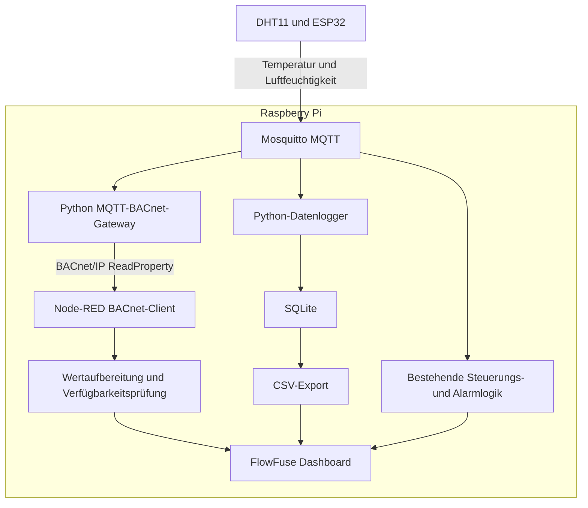
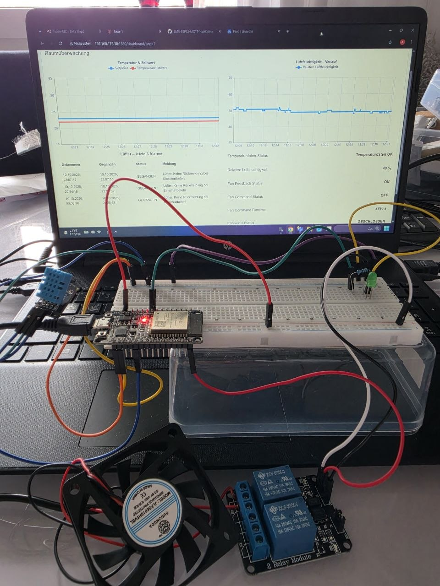
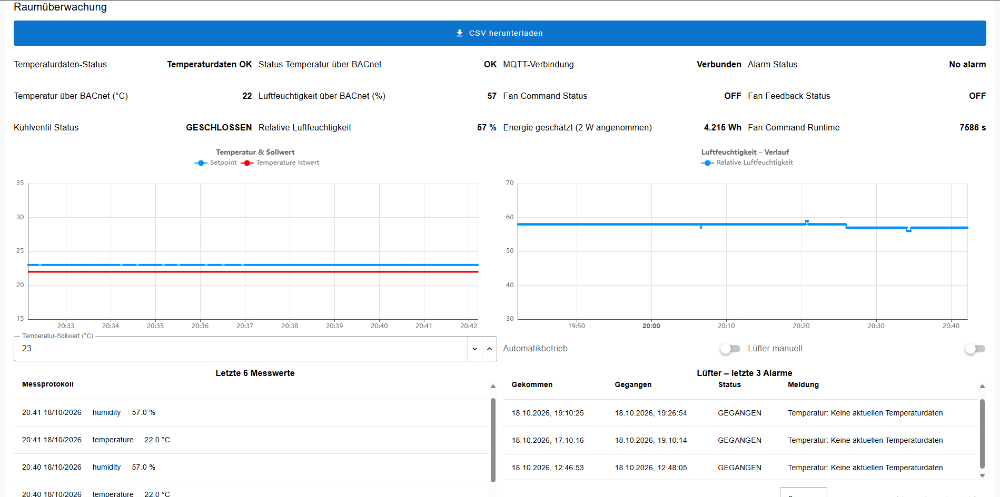
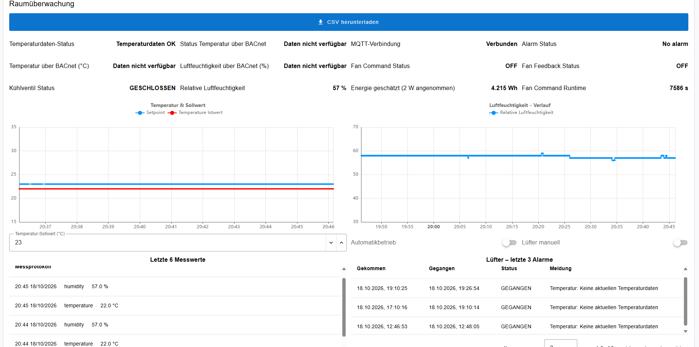
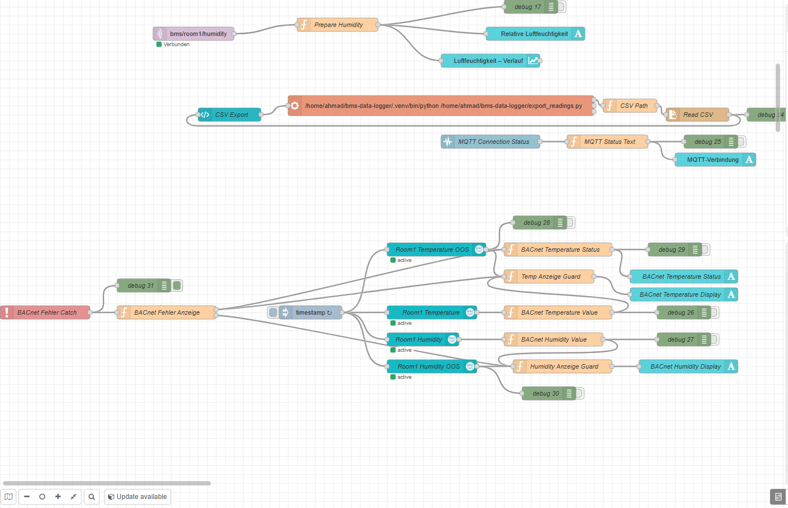
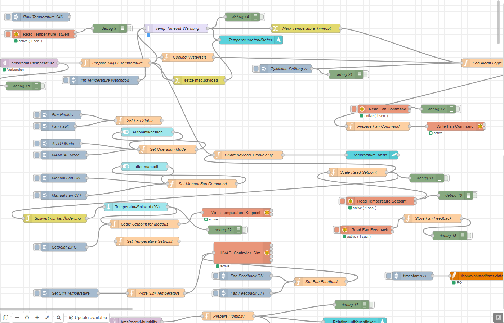
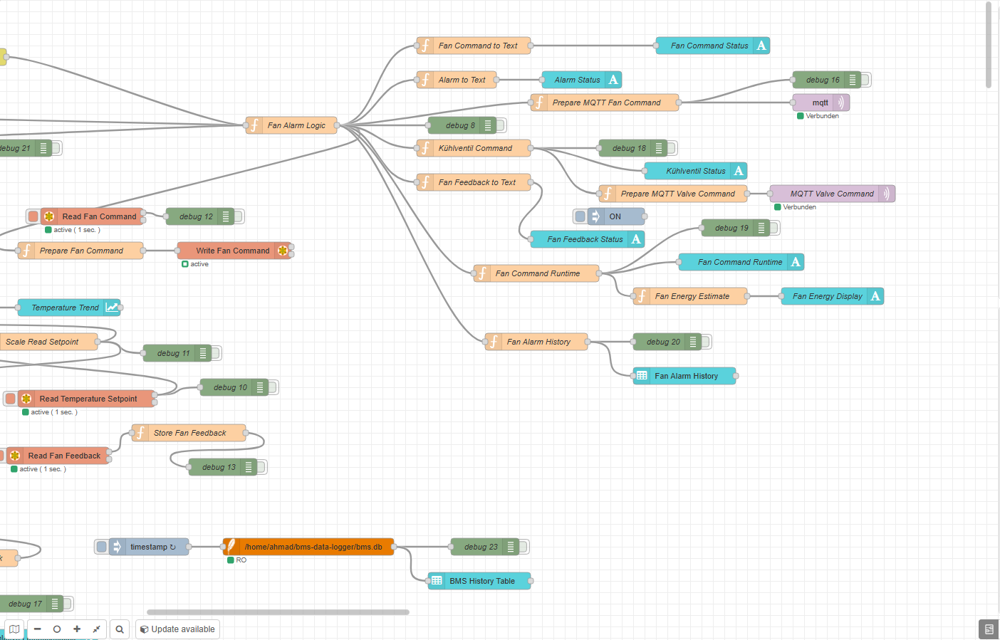
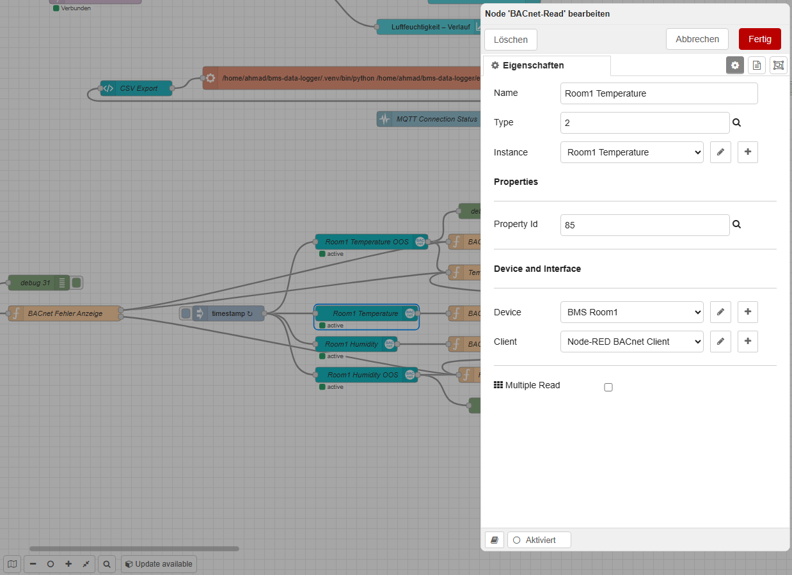
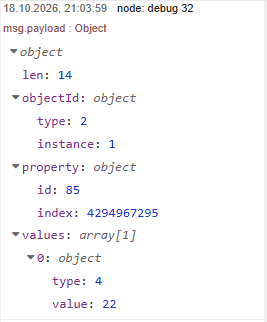

# BMS MQTT–BACnet/IP Integration

### Gebäudeautomation im Labor: reale Sensorik, Protokollintegration und nachvollziehbare Fehlerbehandlung

**ESP32 · Raspberry Pi · MQTT · BACnet/IP · Node-RED · Python · SQLite**

🇩🇪 [Deutsch](#deutsch) | 🇬🇧 [English](#english)

---

<a id="deutsch"></a>

## Projektübersicht

Dieses persönliche Gebäudeautomationsprojekt erweitert einen bestehenden Raumautomationsaufbau um eine **MQTT–BACnet/IP-Schnittstelle**, historische Messdatenspeicherung und eine überwachte BACnet-Anbindung im Dashboard.

Ein ESP32 erfasst Temperatur und relative Luftfeuchtigkeit mit einem DHT11 und veröffentlicht die Messwerte über MQTT. Eine Python-Anwendung auf dem Raspberry Pi übernimmt diese Werte und stellt sie als BACnet-Objekte bereit.

Node-RED liest die BACnet-Datenpunkte zyklisch aus und zeigt sowohl die Messwerte als auch deren Verfügbarkeit an. Bei fehlenden Sensordaten oder einer nicht erreichbaren BACnet-Anwendung werden die betroffenen BACnet-Anzeigen durch **„Daten nicht verfügbar“** ersetzt.

Ergänzend speichert ein separater Python-Datenlogger die MQTT-Messwerte in SQLite. Die gespeicherten Daten können über das Dashboard als CSV heruntergeladen werden.

**Ziel:** Den vollständigen Weg vom realen Sensor über eine Protokollschnittstelle bis zur Visualisierung verstehen, umsetzen und unter gezielt erzeugten Fehlerbedingungen prüfen.

> Persönlicher Labor- und Lernaufbau für einen Raum. Der BACnet-Server ist eine Softwareimplementierung und kein industrieller DDC-Controller.

## Ausgangsprojekt und Weiterentwicklung

Dieses Projekt baut auf folgendem Projekt auf:

**[BMS-ESP32-MQTT-HVAC](https://github.com/ahmad-energy-iot/BMS-ESP32-MQTT-HVAC)**

Der Ausgangsaufbau umfasst reale Sensorik und Lüfteransteuerung, MQTT-Kommunikation, einen Modbus-TCP-Simulator, Hystereseregelung, Betriebsarten, Alarmhistorie und eine Energieabschätzung.

Die Erweiterung ergänzt insbesondere:

| Bereich | Erweiterung |
|---|---|
| Protokollintegration | Python-Gateway von MQTT zu BACnet/IP |
| BACnet-Datenmodell | Zwei Analog-Value-Objekte für Temperatur und Luftfeuchtigkeit |
| Datenpunktprüfung | Lesen von Wert, Name, Einheit und Verfügbarkeitskennzeichen |
| Geräteidentifikation | Gerichtete Who-Is-Abfrage und Auslesen der Object List |
| Visualisierung | BACnet-Abfragen aus Node-RED im 5-Sekunden-Intervall |
| Datenverfügbarkeit | Unabhängige Aktualisierungsüberwachung je Messgröße |
| Kommunikationsfehler | Catch-basierte Behandlung von BACnet-Lesefehlern |
| Messdatenhistorie | Python-Datenlogger mit SQLite und SQL-Auswertungen |
| Datenexport | CSV-Download über das Dashboard |
| Alarmierung | Getrennte Ereignisse für Temperaturdatenausfall und fehlende simulierte Lüfterrückmeldung |
| Betrieb | Datenlogger und BACnet-Gateway als systemd-Dienste |

## Gebäudetechnische Planung – praktische Anwendung im eigenen GA-Laborprojekt

Dieser Abschnitt bündelt die **praktische Anwendung von Planungsaufgaben der Gebäudeautomation im persönlichen Einraum-Laborprojekt**: Anforderungen formulieren, Datenpunkte und Schnittstellen zuordnen, Funktionen beschreiben und anhand dokumentierter Tests prüfen.

Die Unterlagen wurden am bestehenden Aufbau nachgeführt und zur Weiterentwicklung strukturiert. Sie dokumentieren eigene Projektpraxis; sie sind keine Ausführungsplanung einer produktiven Gebäudeanlage und kein Nachweis beruflicher Planungserfahrung in Kundenprojekten. Der folgende Anforderungskatalog beschreibt den bestehenden Laborumfang, nicht nachträglich behauptete ursprüngliche Auftraggebervorgaben.

### 1. Anforderungen und Systemgrenzen

| ID | Anforderung für Raum 1 | Zugeordnete Punkte |
|---|---|---|
| R01 | Reale Temperatur und relative Luftfeuchtigkeit erfassen und visualisieren. | DP01–DP02 |
| R02 | Im AUTO-Betrieb den realen Lüfter über MQTT/Relais mit einer Hysterese um den Sollwert steuern; bei 23 °C Sollwert EIN ab 24 °C, AUS bis einschließlich 22 °C. | DP01, DP03–DP05 |
| R03 | AUTO/MANUAL über den Dashboard-Schalter „Automatikbetrieb“ umschalten und im manuellen Betrieb über „Lüfter manuell“ einen Lüfterbefehl vorgeben; alternativ stehen Inject-Nodes im Editor zur Verfügung. | DP04–DP05 |
| R04 | Den dargestellten Kühlventilzustand nur bei Kühlbedarf, Lüfterbefehl EIN, simulierter Lüfterrückmeldung EIN und ohne Temperaturdaten-Timeout freigeben. | DP05–DP07, DP10 |
| R05 | Temperatur und Luftfeuchtigkeit als BACnet-Softwareobjekte bereitstellen und je Messgröße die Aktualität überwachen. | DP01–DP02, DP08–DP09 |
| R06 | Bei erkannter Nichtverfügbarkeit der Quelldaten oder BACnet-Lesefehlern die betroffene BACnet-Zahlenanzeige durch „Daten nicht verfügbar“ ersetzen; nach Erholung gültige Werte wieder anzeigen. | DP08–DP09, DP12 |
| R07 | Fehlende Temperaturdaten und fehlende simulierte Lüfterrückmeldung bei Einschaltbefehl als getrennte Alarmursachen mit Beginn, Ende und Status dokumentieren. | DP10–DP11 |
| R08 | Temperatur und Luftfeuchtigkeit historisch speichern und als CSV exportieren. | DP01–DP02 |
| R09 | Gateway und Datenlogger als Dienste betreiben und die Wiederaufnahme nach Neustart prüfen. | Gateway / Logger |

**Abgrenzung:** Ein Raum, realer DHT11, ESP32, Relais und 5-V-Lüfter. Kühlventil durch LED dargestellt, Lüfterrückmeldung und Modbus-Station simuliert. BACnet dient dem Lesen und Überwachen; die Lüftersteuerung erfolgt weiterhin über MQTT. Keine Auslegung einer realen Lüftungsanlage, keine Gebäudeinstallation und keine zertifizierte Sicherheitsfunktion.

### 2. Zusammengeführte Datenpunkt- und Schnittstellenliste

Die Kennungen DP01–DP12 dienen der Querverweisung in dieser Dokumentation. Sie ändern keine MQTT-Topics, BACnet-Instanzen oder Namen im Flow und sind noch keine zusätzlichen Beschriftungen innerhalb der DXF-Zeichnung.

| ID | Datenpunkt / Funktion | Wert / Einheit | Quelle → Verwendung | Adresse / Zuordnung | Realisierung |
|---|---|---|---|---|---|
| DP01 | Raumtemperatur | Zahl / °C | DHT11, ESP32 → Node-RED, Gateway, Logger | GPIO4; MQTT `bms/room1/temperature`; BACnet `analog-value,1`, `present-value` | Reale Messung; BACnet-Softwarewert |
| DP02 | Relative Luftfeuchtigkeit | Zahl / % r. F. | DHT11, ESP32 → Node-RED, Gateway, Logger | GPIO4; MQTT `bms/room1/humidity`; BACnet `analog-value,2`, `present-value` | Reale Messung; BACnet-Softwarewert |
| DP03 | Temperatursollwert | Zahl / °C; Standard 23 | Vorgabe / Modbus-Simulator → Regelung | Flow `setpoint`; Modbus Holding Register Offset 0, Skalierung ×10 beim Schreiben / ×0,1 beim Lesen | Softwarevorgabe |
| DP04 | Betriebsart | AUTO / MANUAL | Dashboard-Schalter „Automatikbetrieb“ oder Inject-Nodes → Steuerung | Flow `autoMode`: true / false | Softwarebedienung |
| DP05 | Lüfterbefehl | ON / OFF | Node-RED → ESP32 / Relais; parallel Modbus-Abbild | MQTT `bms/room1/fan/command`; GPIO23, Active LOW; Modbus Coil Offset 0 | Befehl an realen Lüfter; Modbus-Abbild simuliert |
| DP06 | Lüfterrückmeldung | EIN / AUS | Inject / Modbus-Simulator → Überwachung und Ventilfreigabe | Modbus Discrete Input Offset 0; Flow `fanFeedback` | Simuliert; kein Drehzahlnachweis |
| DP07 | Kühlventilbefehl | ON / OFF | Node-RED → ESP32 / LED | MQTT `bms/room1/valve/command`; GPIO26 | LED statt physischem Ventil |
| DP08 | Verfügbarkeit Temperatur über BACnet | Boolean; true = im Labormodell nicht verfügbar | Gateway → Node-RED-Anzeigefreigabe | `analog-value,1`, `out-of-service` (Property 81) | Softwarestatus; kein zusätzlicher Sensor |
| DP09 | Verfügbarkeit Luftfeuchtigkeit über BACnet | Boolean; true = im Labormodell nicht verfügbar | Gateway → Node-RED-Anzeigefreigabe | `analog-value,2`, `out-of-service` (Property 81) | Softwarestatus; kein zusätzlicher Sensor |
| DP10 | Temperaturdatenalarm | Aktiv / gegangen | Temperatur-Watchdog → Alarmhistorie | Nachricht `temperatureDataAlarm`; Historienursache `temperatureTimeout` | Abgeleiteter Softwarealarm |
| DP11 | Lüfterrückmeldungsalarm | Aktiv / gegangen | Befehls-/Rückmeldungsvergleich → Alarmhistorie | Nachricht `fanFeedbackAlarm`; Historienursache `fanFeedback` | Abgeleitet aus realem Befehl und simulierter Rückmeldung |
| DP12 | BACnet-Kommunikationsfehler | Lesefehler / Nichtverfügbarkeit | BACnet-Leseknoten → Catch → betroffene Anzeige | `BACnet Fehler Catch` / `BACnet Fehler Anzeige` | Lokale Fehlerauswertung, kein empfangenes Fehlerobjekt |

Modbus-Adressen sind **nullbasierte Offsets je Datenbereich**. Holding Register 0, Coil 0 und Discrete Input 0 sind verschiedene Adressräume. BACnet-Gerät: Device Instance `123001`, Name `BMS-Room1-Bridge`; die beiden Analog Values gehören zu diesem Softwaregerät. Für DP03–DP07 und DP10–DP12 wird hier kein zusätzliches BACnet-Objekt behauptet.

DP01 und DP02 stammen vom selben DHT11 und werden über MQTT und BACnet unterschiedlich bereitgestellt; diese Wege sind keine unabhängigen Messungen. `Out_Of_Service` ist die bereits beschriebene projektspezifische Laborvereinfachung zur Verfügbarkeit, kein allgemeingültiges BACnet-Kommunikationsfehlermodell.

### 3. Funktionsbeschreibung und Zuordnung zum CAD-Systembild

**Zeichnung BMS-01:** [BMS / MQTT – BACnet/IP: Functional system overview (DXF)](docs/cad/BMS-MQTT-BACnet-IP-system-overview.dxf).

Das Systembild zeigt Komponenten, Funktionswege und Protokollverbindungen. Es ist ein funktionales Übersichtsschema mit vereinfachten Hardwarewegen; Versorgung, Schutzbeschaltung, vollständige Klemmen- und Aderbelegung sind nicht dargestellt. Es ersetzt keinen elektrischen Stromlauf- oder Installationsplan.

| Bezeichnung im CAD-Systembild | Funktion / Dokumentationsbezug |
|---|---|
| DHT11 / ESP32 | DP01–DP02 erfassen; DP05 und DP07 ausgeben |
| RELAY / FAN | DP05 schaltet den realen 5-V-Lüfter |
| LED / Cooling valve represented by LED | DP07 stellt den Ventilbefehl dar |
| MQTT BROKER / Mosquitto | Überträgt Messwerte DP01–DP02 und Befehle DP05, DP07 |
| Node-RED / Control + Dashboard | Verarbeitet DP01–DP12; Betriebsarten, Hysterese, Alarmierung und Anzeigen |
| Python Gateway / MQTT to BACnet/IP | Stellt DP01–DP02 als BACnet-Werte und DP08–DP09 als Verfügbarkeitsstatus bereit |
| Modbus TCP simulator | Softwareabbild von Sollwert, Lüfterbefehl und simulierter Rückmeldung DP03, DP05–DP06 |
| Python logger / SQLite | Speichert Messwerte DP01–DP02; Dashboard liest Historie und exportiert CSV |

**Betriebsfolge und Entscheidungen:**

1. **Messen und regeln:** Der ESP32 veröffentlicht Temperatur und Luftfeuchtigkeit ungefähr alle 2 Sekunden. Node-RED berechnet den Kühlbedarf aus der Temperatur. Im AUTO-Betrieb gilt EIN ab Sollwert +1 K und AUS bis einschließlich Sollwert −1 K; dazwischen bleibt der Kühlzustand erhalten. Die Hysterese begrenzt häufiges Umschalten nahe dem Sollwert.
2. **Betriebsart und Lüfter:** `Fan Alarm Logic` wählt im AUTO-Betrieb den Kühlbedarf als Lüfterbefehl; bei erkanntem Temperaturdaten-Timeout wird der AUTO-Befehl AUS. Im MANUAL-Betrieb wird `manualFanCommand` verwendet. Die Betriebsart wird im Dashboard über „Automatikbetrieb“ vorgegeben, der manuelle Lüfterbefehl über „Lüfter manuell“. Alternativ können die vorhandenen Inject-Nodes im Editor verwendet werden.
3. **Rückmeldung und Ventildarstellung:** `Kühlventil Command` gibt die Ventil-LED nur frei, wenn Kühlbedarf, Lüfterbefehl und simulierte Rückmeldung true sind und kein Temperaturdaten-Timeout anliegt. Die LED ist damit eine bedingte Funktionsdarstellung, kein Nachweis eines realen Ventils.
4. **Alarmierung:** Der Temperatur-Watchdog im Node-RED-Flow ist auf 5 Sekunden eingestellt. Bei Lüfterbefehl EIN ohne simulierte Rückmeldung startet eine 5-Sekunden-Überwachung; die Auswertung erfolgt beim nächsten Steuerungs- bzw. Prüftakt. Der aktuelle Flow enthält dafür einen 1-Sekunden-Prüftakt. Beide Alarmursachen werden getrennt in der auf drei Ereignisse begrenzten Historie geführt. Dies sind keine garantierten Echtzeitfristen.
5. **BACnet-Überwachung:** Das Gateway überwacht beide Messgrößen unabhängig mit einer 15-Sekunden-Aktualisierungsfrist. Node-RED liest Werte und Verfügbarkeitsstatus alle 5 Sekunden. Quelle ausgefallen und Gateway nicht erreichbar werden über unterschiedliche Mechanismen erkannt: Punktstatus bzw. Catch der BACnet-Lesefehler. Erst nach Erkennung wird die betroffene Zahlenanzeige ersetzt; Polling und Timeout verursachen Verzögerungen.
6. **Historie:** Ein separater Logger speichert geeignete MQTT-Messwerte mit mindestens 60 Sekunden Abstand je Messgröße im laufenden Prozess. Die Aufbewahrungsbedingung beträgt 72 Stunden. Der CSV-Export enthält Messwerte; Alarmhistorie und Lüfterzustände gehören nicht zu diesem Export.

**Umsetzungsbezug:** Die vorhandenen Funktionen und Adressen sind im [aktuellen Node-RED-Flow](flows/bms-mqtt-bacnet-flow.json) nachvollziehbar. GPIO-Zuordnung, Firmware und die ursprünglichen Steuerungstests sind im [Ausgangsprojekt](https://github.com/ahmad-energy-iot/BMS-ESP32-MQTT-HVAC#esp32-anschlüsse) dokumentiert. Einrichtung und Dienstkonfiguration beschreibt [SETUP.md](docs/SETUP.md).

### 4. Anforderungsbezogene Prüfmatrix

Die Spalte „Dokumentierter Stand“ übernimmt bereits berichtete Laborbeobachtungen aus diesem README bzw. dem Ausgangsprojekt. Beim Ergänzen dieser Planungsunterlagen wurde kein neuer Hardwaretest durchgeführt. Quelltextprüfung bestätigt die beschriebene Implementierung, ersetzt aber keine erneute Prüfung am Aufbau.

| Bezug | Prüfschritt | Erwartetes Verhalten | Dokumentierter Stand / offener Nachweis |
|---|---|---|---|
| R01, R05 | Reale Temperatur und Luftfeuchtigkeit über MQTT/Gateway lesen und BACnet-Namen, Werte und Einheiten prüfen. | Beide Werte sind zugeordnet und über BACnet lesbar. | Im bestehenden BACnet-Labortest erfolgreich dokumentiert. |
| R02 | Bei 23 °C Sollwert die Temperatur auf mindestens 24 °C erhöhen und anschließend auf höchstens 22 °C senken. | Lüfter EIN ab 24 °C, AUS bis einschließlich 22 °C. | Hysteresetest und reale MQTT-/Relaisansteuerung im Ausgangsprojekt dokumentiert. |
| R02 | Im Zwischenbereich nach EIN und nach AUS prüfen. | Vorheriger Kühlzustand bleibt erhalten. | Im aktuellen Quelltext nachvollziehbar; separate Mess-/Testaufzeichnung beider Richtungen noch offen. |
| R03 | AUTO/MANUAL und manuellen EIN-/AUS-Befehl bei unterschiedlichen Kühlbedarfen prüfen. | Im MANUAL-Betrieb folgt der Lüfter der manuellen Vorgabe; bei AUTO wieder der Regelung. | Bedienpfad und Logik vorhanden; vollständige dokumentierte Umschaltprüfung noch offen. |
| R04 | Ventilfreigabe mit Kühlbedarf, Lüfterbefehl, simulierter Rückmeldung und Temperatur-Timeout einzeln variieren. | LED nur bei allen Freigabebedingungen EIN. | Im Labor getestet: Bei Kühlbedarf und Lüfterbefehl EIN öffnet die Ventil-LED mit simulierter Rückmeldung EIN und schließt mit Rückmeldung AUS. Die systematische Einzelprüfung aller weiteren Freigabebedingungen bleibt offen. |
| R06, R07 | Sensordaten unterbrechen und wieder aufnehmen. | Temperaturdatenalarm; betroffene BACnet-Anzeigen nach Erkennung nicht verfügbar; Erholung nach neuen gültigen Werten. | Unterbrechung und Erholung dokumentiert; beide Überwachungswege haben unterschiedliche Fristen. |
| R05, R06 | Nur Luftfeuchteaktualisierung pausieren, anschließend fortsetzen. | Luftfeuchtigkeit nicht verfügbar, Temperatur bleibt verfügbar; anschließende Erholung. | Unabhängiger Timeout und Erholung ohne Neustart der Testanwendung dokumentiert. |
| R06 | BACnet-Dienst stoppen und starten. | Lesefehler wird erfasst, betroffene Anzeigen melden Nichtverfügbarkeit; anschließend Rückkehr gültiger Werte. | `ERR_TIMEOUT`, Ersatzanzeige und Wiederkehr dokumentiert. |
| R07 | Lüfterbefehl EIN mit simulierter Rückmeldung AUS, danach Rückmeldung wieder EIN. | Rückmeldungsalarm nach Auswertung der Verzögerung; Beginn und Ende in der Historie. | Alarmbeginn/-ende mit simulierter Rückmeldung im Ausgangsprojekt dokumentiert. |
| R07 | Beide Alarmursachen gleichzeitig auslösen und getrennt zurücknehmen. | Zwei getrennte Ereignisse; jede Ursache wird unabhängig beendet. | Im Labor erfolgreich getestet: Beide Alarmursachen gleichzeitig aktiv; jede Ursache wird unabhängig zurückgenommen und mit eigenem Beginn, Ende und Status in der Historie geführt. |
| R08 | SQLite-Daten lesen, CSV anfordern und Export öffnen. | Gespeicherte Messwerte lesbar; CSV nach Betätigung verfügbar. | SQL-Auswertung, Download und Öffnen im Tabellenprogramm dokumentiert. |
| R08 | Altersbedingte Bereinigung prüfen. | Datensätze älter als 72 Stunden werden bei ausgeführter Bereinigung entfernt. | Bedingung in temporärer Testdatenbank geprüft; mehrtägige Dauerbeobachtung nicht dokumentiert. |
| R09 | Raspberry Pi neu starten. | Gateway und Logger starten automatisch; Messwerte wieder verfügbar. | Im bestehenden README als erfolgreicher Neustarttest dokumentiert. |

Die offenen Prüfungen sind konkrete nächste Arbeitsschritte am Laboraufbau. Ihre Auflistung ist kein bereits erbrachter Testerfolg. Die Planungsübung zeigt die Verknüpfung von Anforderungen, Datenpunkten, Funktionen, Systembild und Prüfungen; eine formale Planprüfung oder Abnahme einer Gebäudeanlage ist damit nicht verbunden.

---

## Architektur



Die bestehenden MQTT-Steuerungsfunktionen bleiben erhalten.

**Das BACnet-Gateway stellt Messwerte bereit. Die Lüfterregelung wurde nicht auf BACnet übertragen.**

Die direkte MQTT-Anzeige und die BACnet-Anzeige verwenden dieselbe physische Sensorquelle. Es handelt sich nicht um zwei unabhängige Messsysteme.

## Hardware und Software

| Bestandteil | Aufgabe |
|---|---|
| ESP32 mit MicroPython | Sensorabfrage, MQTT-Veröffentlichung und Ausgangsansteuerung im bestehenden BMS |
| DHT11 | Reale Temperatur- und Luftfeuchtemessung |
| Raspberry Pi | Plattform für Broker, Node-RED und Python-Anwendungen |
| Mosquitto | MQTT-Broker |
| Python / BACpypes3 | Bereitstellung der BACnet/IP-Geräte- und Datenpunktstruktur |
| paho-mqtt | MQTT-Empfang in den Python-Anwendungen |
| Node-RED | Integration, bestehende Steuerungslogik und Fehlerbehandlung |
| FlowFuse Dashboard | Visualisierung, Bedienung und CSV-Download |
| SQLite | Lokale Speicherung der Messdaten |
| systemd | Hintergrundbetrieb der Python-Dienste |
| Relais und 5-V-Lüfter | Reale Aktoransteuerung im bestehenden Aufbau |
| LED | Darstellung eines Kühlventils |
| Modbus-TCP-Simulator | Bestehende Sollwert-, Befehls- und Rückmeldungsintegration |

### Verwendete Versionen im Labor

| Komponente | Version / Umgebung |
|---|---|
| Betriebssystem | Debian GNU/Linux 13, ARM64 |
| Python | 3.13.5 |
| BACpypes3 | 0.0.110 |
| paho-mqtt | 2.1.0 |
| FlowFuse Dashboard | 1.32.0 |
| node-red-contrib-bacnet | 0.3.0 |

Die Angaben dokumentieren die verwendete Testumgebung und sind keine allgemeine Kompatibilitätszusage für andere Versionen.

## BACnet/IP-Datenpunkte

Das Gateway stellt ein Softwaregerät mit folgender Identität bereit:

| Eigenschaft | Wert |
|---|---|
| Device Instance | `123001` |
| Device Name | `BMS-Room1-Bridge` |
| BACnet/IP-Serverport | UDP `47808` |

### Datenpunktliste

| Messgröße | MQTT-Topic | BACnet Object Identifier | Object Name | Einheit |
|---|---|---|---|---|
| Temperatur | `bms/room1/temperature` | `analog-value,1` | `Room1_Temperature` | `degrees-celsius` |
| Relative Luftfeuchtigkeit | `bms/room1/humidity` | `analog-value,2` | `Room1_Humidity` | `percent-relative-humidity` |

Die Analog-Value-Objekte repräsentieren Softwarewerte aus MQTT. Sie sind keine physischen Analogeingänge eines industriellen BACnet-Controllers.

### Gelesene Eigenschaften

- `present-value`: aktueller, im Gateway gespeicherter Wert.
- `object-name`: Name des Datenpunkts.
- `units`: technische Einheit.
- `out-of-service`: im Labor verwendetes Kennzeichen für nicht verfügbare Gateway-Daten.
- `object-list` am Device Object: Liste der bereitgestellten Objekte.

**Device Instance und Object Instance sind unterschiedliche Kennungen.**

Beispiel: `123001` identifiziert das Gerät. `analog-value,1` identifiziert das Temperatur-Object innerhalb dieses Geräts.

## MQTT–BACnet-Gateway

Das Gateway:

1. verbindet sich mit dem lokalen MQTT-Broker,
2. abonniert die beiden Messwerttopics,
3. prüft eingehende Werte,
4. aktualisiert die jeweilige BACnet-Eigenschaft,
5. überwacht den Zeitpunkt der letzten gültigen Aktualisierung.

### Validierung und Aktualisierung

- Nicht numerische und nicht endliche Werte werden verworfen.
- Luftfeuchtigkeit muss zwischen `0` und `100` liegen.
- Retained-Nachrichten werden nicht als neue Sensormessungen übernommen.
- Temperatur und Luftfeuchtigkeit werden unabhängig voneinander überwacht.
- MQTT-Callbacks übergeben Aktualisierungen mittels `loop.call_soon_threadsafe()` an die asyncio-Ereignisschleife.

Eine MQTT-Nachricht aktualisiert den Gateway-Wert. Der BACnet-Client kann diesen Wert anschließend mit `ReadProperty` abfragen.

### Überwachung fehlender Messwerte

Die konfigurierte Aktualisierungsfrist beträgt **15 Sekunden je Messgröße**.

Ohne neue gültige Messung wird die betreffende Punktverfügbarkeit umgeschaltet. Nach Eingang einer neuen gültigen Messung wird sie automatisch zurückgesetzt.

Der letzte Zahlenwert bleibt intern erhalten. Beim Start ist der Initialwert `0.0` ein Platzhalter und keine Sensormessung.

> **Bewusste Laborvereinfachung:** Das Gateway verwendet `Out_Of_Service` und das entsprechende Status-Flag zur Darstellung fehlender Quelldaten. Daraus folgt nicht, dass `Out_Of_Service` bei beliebigen BACnet-Geräten allgemein einen Kommunikationsausfall bezeichnet. Für eine produktive Integration wäre ein zum Gerät und zur Anwendung passendes Qualitätsmodell, beispielsweise unter Einbeziehung von Reliability, festzulegen.

Die Überwachung erfolgt zyklisch; die Reaktion ist keine garantierte Echtzeitauslösung exakt nach 15 Sekunden.

## BACnet-Integration in Node-RED

Node-RED arbeitet als BACnet-Client und fragt vier Eigenschaften zyklisch ab:

| Leseknoten | Object Type | Object Instance | Property ID | Bedeutung |
|---|---:|---:|---:|---|
| `Room1 Temperature` | 2 | 1 | 85 | Temperaturwert |
| `Room1 Humidity` | 2 | 2 | 85 | Luftfeuchtewert |
| `Room1 Temperature OOS` | 2 | 1 | 81 | Verfügbarkeitskennzeichen Temperatur |
| `Room1 Humidity OOS` | 2 | 2 | 81 | Verfügbarkeitskennzeichen Luftfeuchtigkeit |

- Object Type `2`: Analog Value.
- Property `85`: Present Value.
- Property `81`: Out Of Service.
- Abfrageintervall: **5 Sekunden**.
- Konfigurierter APDU-Timeout im Node-RED-Client: **6000 ms**.

Die aktuelle Visualisierung verwendet **Polling, keine COV-Subscription**.

### Aufbereitung der Antworten

Die Funktionen `BACnet Temperature Value` und `BACnet Humidity Value` lesen den Wert aus:

```javascript
msg.payload.values[0].value
```

Nach Prüfung wird der Messwert als numerischer `msg.payload` an die Anzeigeaufbereitung weitergegeben.

### Verfügbarkeitsabhängige Anzeige

Die Funktionen:

- `Temp Anzeige Guard`
- `Humidity Anzeige Guard`

führen Wert und OOS-Zustand für die jeweilige Messgröße zusammen.

| Zustand | BACnet-Messwertanzeige |
|---|---|
| Wert gültig und Punkt verfügbar | Zahlenwert |
| Punkt als nicht verfügbar gemeldet | `Daten nicht verfügbar` |
| Noch kein gültiger Verfügbarkeitszustand bekannt | Keine Freigabe eines Zahlenwerts |

Bei Rückkehr der Verfügbarkeit wird die nächste gültige Wertantwort angezeigt.

Es wird ausdrücklich ein Ersatztext gesendet. Ein bloßes `return null` würde die alte Anzeige unverändert lassen.

### Kommunikationsfehler

Wenn der BACnet-Dienst nicht antwortet, kann auch dessen OOS-Eigenschaft nicht gelesen werden.

Deshalb überwacht `BACnet Fehler Catch` die BACnet-Leseknoten. Die Funktion `BACnet Fehler Anzeige` ordnet den Fehler anhand des Quellknotens der Temperatur oder Luftfeuchtigkeit zu.

Bei einem Lesefehler werden die betroffenen Anzeigen ebenfalls auf **„Daten nicht verfügbar“** gesetzt.

Die intern erzeugte Meldung ist eine Anzeigeinformation von Node-RED und keine empfangene BACnet-Antwort des ausgefallenen Geräts.

Die aktuelle Fehlerzuordnung verwendet Knotennamen. Änderungen dieser Namen erfordern eine entsprechende Anpassung der Zuordnung.

## SQLite-Messdatenhistorie

Ein separater Python-Datenlogger empfängt die MQTT-Messwerte und speichert sie in:

```text
bms.db
```

Temperatur und Luftfeuchtigkeit kommen als getrennte MQTT-Nachrichten an und werden deshalb als getrennte Datensätze gespeichert.

| Spalte | Inhalt |
|---|---|
| `id` | Datensatzkennung |
| `received_at` | Empfangszeitpunkt auf dem Raspberry Pi |
| `room` | Raumkennung |
| `metric` | Messgröße |
| `value` | Numerischer Messwert |
| `unit` | Einheit |

### Speicherintervall und Aufbewahrung

- Mindestens **60 Sekunden zwischen zwei gespeicherten Werten derselben Messgröße** innerhalb eines laufenden Logger-Prozesses.
- Speicherung der ersten geeigneten Nachricht nach Ablauf dieses Intervalls.
- Löschung von Datensätzen, deren Empfangszeit mehr als **72 Stunden** zurückliegt.
- Bereinigung beim Programmstart und während des laufenden Empfangs.
- Kein Hintergrundlöschen bei gestopptem Datenlogger.
- Keine nachträgliche Rekonstruktion von Messungen, die während eines Ausfalls nicht empfangen wurden.

Ein Neustart des Loggers setzt die im Arbeitsspeicher gehaltene Intervallverwaltung zurück.

Gelöschter Speicherplatz kann von SQLite wiederverwendet werden; die Dateigröße muss dadurch nicht unmittelbar sinken.

### SQL-Auswertungen

Praktisch verwendet wurden:

- Anzahl gespeicherter Messungen.
- Anzeige der letzten Datensätze.
- Durchschnitt, Minimum und Maximum.
- Getrennte Auswertung nach Messgröße mit `GROUP BY`.

Die berechneten Mittelwerte beziehen sich auf gespeicherte Stichproben und sind keine automatisch zeitgewichteten Mittelwerte.

## CSV-Export

Das Dashboard bietet einen Button **„CSV herunterladen“**.

Der Export enthält die zum Exportzeitpunkt in SQLite verfügbaren Temperatur- und Luftfeuchtedatensätze:

```text
id;received_at;room;metric;value;unit
```

- Semikolon als Trennzeichen.
- UTF-8 mit BOM zur Unterstützung der Darstellung in Tabellenprogrammen.
- Download im Browser.
- Verarbeitung als Exportdatei ohne Änderung der Quelldaten.
- Anforderungskennung zur Zuordnung des Downloads zu einer neuen Betätigung des Buttons.

Nach einer Korrektur der Downloadlogik wurde geprüft, dass ein Deploy keinen erneuten automatischen Download auslöst und eine neue Betätigung einen Download anstößt.

Der CSV-Export umfasst Messwerte, nicht die separate Alarmhistorie oder Lüfterzustände.

## Erweiterte Alarmierung

Neben der BACnet-Anzeige wurde die bestehende Alarmverarbeitung erweitert.

### Getrennte Alarmursachen

- Fehlende Temperaturdaten.
- Lüfterbefehl `ON` ohne simulierte Rückmeldung nach Ablauf der Überwachungsverzögerung.

Beide Ursachen können gleichzeitig aktiv sein. Die Alarmhistorie führt dafür getrennte Ereignisse mit:

- Beginn,
- Ende,
- Status `AKTIV` oder `GEGANGEN`,
- ursachenspezifischer Meldung.

Aktive Ereignisse werden bevorzugt berücksichtigt; die Anzeige bleibt auf drei Einträge begrenzt.

Die Lüfterrückmeldung bleibt simuliert. Ein Lüfterbefehl und eine simulierte Rückmeldung sind kein Nachweis einer gemessenen mechanischen Drehung.

## Betrieb als systemd-Dienste

| Dienst | Aufgabe |
|---|---|
| `bms-logger.service` | MQTT-Messwerte in SQLite speichern |
| `bms-bacnet.service` | MQTT-Messwerte über BACnet/IP bereitstellen |

Die BACnet-Serviceversion liest MQTT-Zugangsdaten aus einer lokalen JSON-Konfiguration außerhalb des Programmquelltexts.

Die Dienste wurden im laufenden Betrieb geprüft. Für den BACnet-Dienst wurden auch Stoppen, Starten und anschließende BACnet-Lesezugriffe getestet.

Ein vollständiger Neustart des Raspberry Pi wurde erfolgreich getestet. Die Dienste starteten automatisch, und die Messwerte waren anschließend wieder verfügbar.

### Ports im getesteten Aufbau

| Anwendung | Port |
|---|---:|
| MQTT-Broker | TCP 1883 |
| BACnet-Gateway | UDP 47808 |
| BACpypes3-Testclient | UDP 47809 |
| Node-RED-BACnet-Client | UDP 47810 |

Gateway und Clients liefen auf demselben Raspberry Pi. Separate lokale BACnet-Ports vermeiden Portkonflikte.

## Praktisch getestete Szenarien

| Szenario | Beobachtetes Ergebnis |
|---|---|
| Erste BACnet-Verbindung mit festem Testwert | Wert, Name und Einheit erfolgreich gelesen |
| Reale MQTT-Temperatur über BACnet lesen | Sensorwert im BACnet-Client verfügbar |
| Reale Luftfeuchtigkeit über BACnet lesen | Wert, Einheit und Object Name verfügbar |
| Gerichtete Who-Is-Abfrage | Antwort mit Device Instance und Adresse |
| Object List lesen | Device, Network Port und beide Analog Values sichtbar |
| ESP32 unterbrechen und wieder anschließen | Gateway-Verfügbarkeit ändert sich und erholt sich nach neuen Messungen |
| Nur Luftfeuchteaktualisierung nach erfolgreichem Empfang pausieren | Luftfeuchtigkeit wird nicht verfügbar; Temperatur bleibt verfügbar |
| Luftfeuchteaktualisierung fortsetzen | Automatische Erholung ohne Neustart der Testanwendung |
| BACnet-Messwerte in Node-RED lesen | Werte erfolgreich extrahiert und im Dashboard angezeigt |
| Sensordaten unterbrechen | Betroffene BACnet-Zahlenanzeigen werden durch Ersatztext ersetzt |
| BACnet-Dienst stoppen | `ERR_TIMEOUT` wird erfasst; Anzeigen melden Nichtverfügbarkeit |
| BACnet-Dienst starten | Zahlenwerte und Status kehren zurück |
| MQTT-Broker unterbrechen und starten | Datenlogger speichert anschließend wieder neue Messwerte |
| SQLite-Daten lesen | Gespeicherte Datensätze und SQL-Zusammenfassungen verfügbar |
| Aufbewahrungsbedingung prüfen | Datumsbasierte Löschbedingung in temporärer Testdatenbank geprüft |
| CSV-Download | Export im Browser heruntergeladen und in einem Tabellenprogramm geöffnet |
| CSV nach Deploy | Ungewollter automatischer erneuter Download durch Anpassung behoben |

Der MQTT-Wiederanlauftest bestätigt die Rückkehr neuer gespeicherter Messwerte. Er unterscheidet nicht abschließend zwischen Wiederverbindung innerhalb des Prozesses und einem Neustart durch systemd.

Die Aufbewahrungsbedingung wurde in einer temporären Datenbank getestet; dies ersetzt keine mehrtägige Dauerbeobachtung der Bereinigung.

## Real, simuliert und geschätzt

| Bestandteil | Umsetzung |
|---|---|
| Temperatur und Luftfeuchtigkeit | Reale DHT11-Messwerte |
| MQTT- und BACnet-Kommunikation | Tatsächliche Protokollkommunikation im Labor |
| BACnet-Gerät | Python-Softwaregerät auf dem Raspberry Pi |
| Industrieller BACnet-DDC-Controller | Nicht verwendet |
| Lüfter | Reales 5-V-Gerät im bestehenden BMS |
| Lüfterrückmeldung | Simuliert |
| Kühlventil | Durch LED dargestellt |
| Modbus-Automationsstation | Simulator in Node-RED |
| Lüfterlaufzeitanzeige | Dauer des ON-Befehls |
| Energieanzeige | Abschätzung mit angenommener Leistung von 2 W |

## Einrichtung und Reproduzierbarkeit

Die Implementierung besteht aus ESP32-Firmware, Node-RED-Flow, Python-Anwendungen, Python-Abhängigkeiten und systemd-Konfigurationen.

Für die Einrichtung sind insbesondere erforderlich:

1. Raspberry Pi mit Python, Node-RED und Mosquitto vorbereiten.
2. Die im Flow verwendeten Dashboard-, Modbus-, SQLite- und BACnet-Pakete installieren.
3. Die benötigten Python-Umgebungen und Abhängigkeiten einrichten.
4. MQTT-Broker und Zugangsdaten lokal konfigurieren.
5. SQLite-Tabelle mit dem Initialisierungsskript anlegen.
6. Netzwerkadressen und BACnet-Ports für die eigene Umgebung anpassen.
7. Eindeutige Device Instances und MQTT Client IDs verwenden.
8. Den benannten Node-RED-Kontextspeicher `file` für persistente Alarm- und Zählerdaten konfigurieren.
9. Den zu dieser Projektversion gehörenden Flow importieren.
10. Dienstdateien an Benutzer, Pfade und Netzwerkumgebung anpassen.
11. Dienste starten und Messwerte, Verfügbarkeit und Fehlerreaktionen prüfen.

Die lokale Testadresse war `192.168.178.38/24`. Sie ist kein allgemeiner Standardwert.

Lokale Zugangsdaten, laufende Datenbanken und gespeicherte Kontextwerte sind keine Voraussetzung für die Veröffentlichung des Quellcodes. Eine vollständige Wiederherstellung auf einem frisch installierten System wurde noch nicht getestet.

## Grenzen und offener Ausbau

- Laboraufbau für einen Raum.
- Kein BTL-zertifiziertes BACnet-Produkt.
- Keine zertifizierte Sicherheitssteuerung.
- Kein Test mit einem industriellen DDC-Controller.
- Keine Inbetriebnahme in einem produktiven Gebäude.
- BACnet-Integration derzeit zum Lesen und Überwachen.
- Keine implementierte BACnet-Sollwertschreibung oder Priority-Array-Steuerung.
- Keine getestete COV-Subscription.
- Keine erprobte BACnet-MS/TP-, BBMD- oder BACnet/SC-Integration.
- Vollständiger Wiederherstellungstest auf einem frisch installierten System ausstehend.
- Verfügbarkeit wird durch das projektspezifische OOS-Modell dargestellt.
- Abfrage-, Überwachungs- und Netzwerkzeiten sind keine garantierten Echtzeitfristen.

In einer separaten COV-Testversion wurde `covIncrement` konfiguriert und gelesen. Eine erfolgreiche Benachrichtigungsübertragung wurde nicht nachgewiesen; die aktive Dashboard-Anbindung verwendet Polling.

## Erarbeitete Kenntnisse

- Ein bestehendes Gebäudeautomationsprojekt um eine weitere Protokollschnittstelle erweitern.
- MQTT-Topics auf BACnet-Objekte abbilden.
- Device, Object und Property unterscheiden.
- Geräteidentität und Objektlisten lesen.
- BACnet-Messwerte und Zustandsinformationen integrieren.
- Fehlende Quelldaten von einer nicht antwortenden Gateway-Anwendung unterscheiden.
- Veraltete Zahlenanzeigen bei erkannten Fehlern durch eindeutige Zustände ersetzen.
- Zeitreihendaten in SQLite speichern und mit SQL auswerten.
- Messwerte als CSV bereitstellen.
- Python-Anwendungen als Linux-Dienste betreiben.
- Tests, reale Komponenten, Simulationen und offene Punkte nachvollziehbar dokumentieren.

---

<a id="english"></a>

## Project Overview

This personal building automation laboratory extends an existing room automation project with a **MQTT-to-BACnet/IP gateway**, historical measurement storage and monitored BACnet dashboard integration.

An ESP32 measures temperature and relative humidity using a DHT11 and publishes the readings over MQTT. A Python application on a Raspberry Pi maps these measurements to BACnet objects.

Node-RED polls the BACnet properties and displays both values and availability information. When sensor updates are missing or the BACnet application cannot be reached, the affected BACnet measurement displays show **“Daten nicht verfügbar”** instead of retaining an apparently current number.

A separate Python logger stores MQTT measurements in SQLite. Stored readings can be downloaded as CSV through the dashboard.

**Purpose:** Implement and understand the path from a physical sensor through a protocol gateway to a supervisory interface, including deliberately introduced failure conditions.

### Previous Project

This project builds on:

**[BMS-ESP32-MQTT-HVAC](https://github.com/ahmad-energy-iot/BMS-ESP32-MQTT-HVAC)**

The original setup provides physical sensor readings and fan switching, MQTT communication, Modbus TCP simulation, hysteresis control, operating modes, alarm history and an energy estimate.

### Main Extensions

- MQTT-to-BACnet/IP integration using Python and BACpypes3.
- Two Analog Value objects for real temperature and humidity readings.
- Directed device discovery and Object List inspection.
- BACnet polling from Node-RED every five seconds.
- Independent update monitoring for each measurement.
- Availability-dependent dashboard displays.
- Catch-based handling of BACnet read failures.
- SQLite measurement storage and SQL summaries.
- Browser-based CSV download.
- Separate alarm records for missing temperature data and missing simulated fan feedback.
- Background operation through systemd.

## Building Services Planning – Practical Application in a Personal GA Laboratory Project

This section consolidates **practical building automation planning tasks in a personal single-room laboratory project**: defining requirements, mapping data points and interfaces, describing functions, and checking them against documented tests.

The documents were developed retrospectively on the existing setup and structured to support further development. They demonstrate personal project practice, not execution planning for a production building or professional planning experience in customer projects. The requirements below describe the existing laboratory scope, not a claimed original client specification.

### 1. Requirements and System Boundaries

| ID | Requirement for Room 1 | Related points |
|---|---|---|
| R01 | Acquire and display real temperature and relative humidity measurements. | DP01–DP02 |
| R02 | In AUTO mode, control the real fan over MQTT/relay using setpoint hysteresis: at a 23 °C setpoint, ON at or above 24 °C and OFF at or below 22 °C. | DP01, DP03–DP05 |
| R03 | Switch between AUTO/MANUAL using the dashboard switch “Automatikbetrieb” and issue manual fan commands using “Lüfter manuell”; editor Inject nodes are available as an alternative. | DP04–DP05 |
| R04 | Enable the represented cooling valve only with cooling demand, fan command ON, simulated fan feedback ON, and no temperature-data timeout. | DP05–DP07, DP10 |
| R05 | Expose temperature and humidity as BACnet software objects and monitor freshness separately for each measurement. | DP01–DP02, DP08–DP09 |
| R06 | After detecting unavailable source data or BACnet read errors, replace the affected BACnet numeric display with “Daten nicht verfügbar”; restore valid readings after recovery. | DP08–DP09, DP12 |
| R07 | Record missing temperature data and missing simulated fan feedback during an ON command as separate alarm causes, with start, end and status. | DP10–DP11 |
| R08 | Store temperature and humidity history and export measurements as CSV. | DP01–DP02 |
| R09 | Run the gateway and logger as services and check recovery after a restart. | Gateway / logger |

**Scope:** One room, physical DHT11, ESP32, relay and 5 V fan. A physical LED represents the cooling valve; fan feedback and the Modbus station are simulated. BACnet provides reading and monitoring; fan control remains on MQTT. This does not include sizing a real ventilation system, a building installation or a certified safety function.

### 2. Unified Data-Point and Interface List

DP01–DP12 are documentation cross-reference IDs. They do not change MQTT topics, BACnet instances or flow names and are not additional labels embedded in the DXF drawing.

| ID | Point / function | Value / unit | Source → use | Address / mapping | Implementation |
|---|---|---|---|---|---|
| DP01 | Room temperature | Number / °C | DHT11, ESP32 → Node-RED, gateway, logger | GPIO4; MQTT `bms/room1/temperature`; BACnet `analog-value,1`, `present-value` | Physical measurement; BACnet software value |
| DP02 | Relative humidity | Number / % RH | DHT11, ESP32 → Node-RED, gateway, logger | GPIO4; MQTT `bms/room1/humidity`; BACnet `analog-value,2`, `present-value` | Physical measurement; BACnet software value |
| DP03 | Temperature setpoint | Number / °C; default 23 | Input / Modbus simulator → control | Flow `setpoint`; Modbus Holding Register offset 0, ×10 on write / ×0.1 on read | Software input |
| DP04 | Operating mode | AUTO / MANUAL | Dashboard switch “Automatikbetrieb” or Inject nodes → control | Flow `autoMode`: true / false | Software operation |
| DP05 | Fan command | ON / OFF | Node-RED → ESP32 / relay; parallel Modbus representation | MQTT `bms/room1/fan/command`; GPIO23, active LOW; Modbus Coil offset 0 | Command to physical fan; simulated Modbus representation |
| DP06 | Fan feedback | ON / OFF | Inject / Modbus simulator → monitoring and valve enable | Modbus Discrete Input offset 0; flow `fanFeedback` | Simulated; no proof of rotation |
| DP07 | Cooling valve command | ON / OFF | Node-RED → ESP32 / LED | MQTT `bms/room1/valve/command`; GPIO26 | LED instead of physical valve |
| DP08 | BACnet temperature availability | Boolean; true = unavailable in the laboratory model | Gateway → Node-RED display guard | `analog-value,1`, `out-of-service` (Property 81) | Software status; no additional sensor |
| DP09 | BACnet humidity availability | Boolean; true = unavailable in the laboratory model | Gateway → Node-RED display guard | `analog-value,2`, `out-of-service` (Property 81) | Software status; no additional sensor |
| DP10 | Temperature-data alarm | Active / cleared | Temperature watchdog → alarm history | Message `temperatureDataAlarm`; history cause `temperatureTimeout` | Derived software alarm |
| DP11 | Fan-feedback alarm | Active / cleared | Command/feedback comparison → alarm history | Message `fanFeedbackAlarm`; history cause `fanFeedback` | Derived from physical command and simulated feedback |
| DP12 | BACnet communication error | Read error / unavailability | BACnet read nodes → Catch → affected display | `BACnet Fehler Catch` / `BACnet Fehler Anzeige` | Local error processing, not a received error object |

Modbus addresses are **zero-based offsets within each data area**. Holding Register 0, Coil 0 and Discrete Input 0 belong to different address spaces. BACnet device: Device Instance `123001`, name `BMS-Room1-Bridge`; both Analog Values belong to this software device. No additional BACnet objects are claimed here for DP03–DP07 or DP10–DP12.

DP01 and DP02 originate from the same DHT11 and are exposed through MQTT and BACnet; these paths are not independent measurements. `Out_Of_Service` is the previously described project-specific availability simplification, not a universally applicable BACnet communication-failure model.

### 3. Functional Description and CAD Overview Mapping

**Drawing BMS-01:** [BMS / MQTT – BACnet/IP: Functional system overview (DXF)](docs/cad/BMS-MQTT-BACnet-IP-system-overview.dxf).

The drawing shows components, functional paths and protocol connections. It is a functional overview with simplified hardware routes; power supplies, protective circuitry and complete terminal/wire assignments are not shown. It does not replace an electrical circuit or installation drawing.

| Label in CAD overview | Function / documentation reference |
|---|---|
| DHT11 / ESP32 | Acquire DP01–DP02; output DP05 and DP07 |
| RELAY / FAN | DP05 switches the physical 5 V fan |
| LED / Cooling valve represented by LED | DP07 represents the valve command |
| MQTT BROKER / Mosquitto | Transfers measurements DP01–DP02 and commands DP05, DP07 |
| Node-RED / Control + Dashboard | Processes DP01–DP12; modes, hysteresis, alarms and displays |
| Python Gateway / MQTT to BACnet/IP | Exposes DP01–DP02 as BACnet values and DP08–DP09 as availability status |
| Modbus TCP simulator | Software representation of setpoint, fan command and simulated feedback DP03, DP05–DP06 |
| Python logger / SQLite | Stores DP01–DP02; dashboard reads history and exports CSV |

**Operating sequence and design decisions:**

1. **Measurement and control:** The ESP32 publishes temperature and humidity approximately every 2 seconds. Node-RED calculates cooling demand from temperature. In AUTO mode, demand switches ON at setpoint +1 K and OFF at or below setpoint −1 K; the cooling state is retained between thresholds. Hysteresis limits repeated switching close to the setpoint.
2. **Mode and fan:** `Fan Alarm Logic` uses cooling demand as the AUTO fan command; a detected temperature-data timeout sets the AUTO command OFF. MANUAL mode uses `manualFanCommand`. The dashboard switch “Automatikbetrieb” sets the operating mode, and “Lüfter manuell” sets the manual fan command. The existing editor Inject nodes can be used as an alternative.
3. **Feedback and valve representation:** `Kühlventil Command` enables the valve LED only when cooling demand, fan command and simulated feedback are true and no temperature-data timeout is active. The LED is a conditional functional representation, not evidence of a physical valve.
4. **Alarms:** The Node-RED temperature watchdog is configured for 5 seconds. Fan command ON without simulated feedback starts a 5-second monitoring period, evaluated on the next control message or check tick. The current flow includes a 1-second check tick. Both causes are tracked separately in a history limited to three events. These are not guaranteed real-time deadlines.
5. **BACnet monitoring:** The gateway monitors both measurements independently using a 15-second freshness limit. Node-RED polls values and availability every 5 seconds. Source failure and unreachable gateway are detected differently: point status versus caught BACnet read errors. The affected numeric display is replaced only after detection; polling and timeouts introduce delays.
6. **History:** A separate logger stores suitable MQTT measurements at least 60 seconds apart for each metric within a running process. The retention condition is 72 hours. CSV exports contain measurements, not alarm history or fan states.

**Implementation references:** Existing functions and addresses can be traced in the [current Node-RED flow](flows/bms-mqtt-bacnet-flow.json). GPIO mapping, firmware and original control tests are documented in the [base project](https://github.com/ahmad-energy-iot/BMS-ESP32-MQTT-HVAC#esp32-connections). [SETUP.md](docs/SETUP.md) describes setup and service configuration.

### 4. Requirements-Based Verification Matrix

“Documented status” refers to previously reported laboratory observations in this README or the base project. No new hardware tests were performed while adding these planning documents. Source inspection confirms implementation details but does not replace a new test on the setup.

| Reference | Test step | Expected behavior | Documented status / remaining evidence |
|---|---|---|---|
| R01, R05 | Read physical temperature and humidity through MQTT/gateway; check BACnet names, values and units. | Both values are mapped and readable over BACnet. | Successful existing BACnet laboratory tests documented. |
| R02 | At a 23 °C setpoint, raise temperature to 24 °C or above, then lower it to 22 °C or below. | Fan ON at or above 24 °C, OFF at or below 22 °C. | Hysteresis test and physical MQTT/relay actuation documented in the base project. |
| R02 | Test the intermediate band after an ON state and after an OFF state. | Previous cooling state is retained. | Traceable in current source; separate recorded tests in both directions remain open. |
| R03 | Switch AUTO/MANUAL and issue manual ON/OFF commands at different cooling demands. | In MANUAL, the fan follows manual input; in AUTO, it returns to control logic. | Operation path and logic present; a complete documented changeover test remains open. |
| R04 | Vary cooling demand, fan command, simulated feedback and temperature timeout individually. | LED ON only when all enable conditions are met. | Tested in the laboratory: With cooling demand and fan command ON, the valve LED opens with simulated feedback ON and closes with feedback OFF. Systematic individual testing of all other enable conditions remains open. |
| R06, R07 | Interrupt sensor data, then resume. | Temperature-data alarm; affected BACnet displays unavailable after detection; recovery after fresh valid values. | Interruption and recovery documented; the two monitoring paths use different timing limits. |
| R05, R06 | Pause only humidity updates, then resume. | Humidity unavailable while temperature remains available; subsequent recovery. | Independent timeout and recovery without restarting the test application documented. |
| R06 | Stop and start the BACnet service. | Read error caught; affected displays show unavailability; valid values return after recovery. | `ERR_TIMEOUT`, replacement display and recovery documented. |
| R07 | Set fan command ON with simulated feedback OFF, then restore feedback ON. | Feedback alarm after the evaluated delay; start and end recorded in history. | Alarm activation/clearance with simulated feedback documented in the base project. |
| R07 | Trigger both alarm causes together and clear them separately. | Two separate events; each cause clears independently. | Successfully tested in the laboratory: Both alarm causes active together; each cause clears independently and is recorded with its own start, end and status in the history. |
| R08 | Read SQLite records, request CSV and open the export. | Stored measurements readable; CSV available after button activation. | SQL queries, download and opening in a spreadsheet documented. |
| R08 | Check age-based cleanup. | Records older than 72 hours removed when cleanup runs. | Condition tested in a temporary database; multi-day observation not documented. |
| R09 | Restart the Raspberry Pi. | Gateway and logger start automatically; measurements become available again. | Successful restart test reported in the existing README. |

Open checks are specific next tasks on the laboratory setup; listing them does not claim they have passed. The planning exercise links requirements, points, functions, the overview drawing and verification; it does not constitute formal plan approval or acceptance of a building installation.

---

## System Roles

| Component | Role |
|---|---|
| DHT11 | Physical temperature and humidity sensor |
| ESP32 | Sensor acquisition and MQTT publishing; output control in the existing BMS |
| Mosquitto | MQTT broker |
| Python gateway | Exposes MQTT measurements as BACnet/IP objects |
| Node-RED | Existing control logic, BACnet client, integration and error handling |
| FlowFuse Dashboard | Supervisory display and operation |
| Python logger / SQLite | Historical measurement storage |
| systemd | Background service management |

**The BACnet gateway does not perform the existing fan control logic.** Control remains in Node-RED.

The MQTT and BACnet displays use the same physical sensor source. They are not independent measurement channels.

## BACnet Data Model

| Item | Configuration |
|---|---|
| Device Instance | `123001` |
| Device Name | `BMS-Room1-Bridge` |
| Temperature | `analog-value,1` / `Room1_Temperature` |
| Humidity | `analog-value,2` / `Room1_Humidity` |
| Temperature units | `degrees-celsius` |
| Humidity units | `percent-relative-humidity` |

The Analog Value objects represent software values received through MQTT, not physical analog inputs of an industrial BACnet controller.

Properties read during testing include:

- `present-value`
- `object-name`
- `units`
- `out-of-service`
- Device `object-list`

The software device was successfully identified using a directed Who-Is request.

### Example Read Requests

Run these inside the BACpypes3 client shell:

```text
whois 192.168.178.38
read 192.168.178.38 device,123001 object-list
read 192.168.178.38 analog-value,1 present-value
read 192.168.178.38 analog-value,1 out-of-service
read 192.168.178.38 analog-value,2 present-value
read 192.168.178.38 analog-value,2 out-of-service
```

The address is specific to the laboratory network and must be adapted elsewhere.

## Data Validation and Availability

The gateway rejects invalid numeric values and requires humidity to be within `0–100%`. Retained MQTT messages are not treated as new sensor samples.

Each measurement has an independent **15-second update timeout**.

The last numeric value remains stored internally. Initial zero values are placeholders, not sensor readings.

> **Laboratory design choice:** `Out_Of_Service` and its corresponding status flag are used as a project-specific indicator of unavailable gateway source data. This must not be generalized to the meaning of OOS on arbitrary BACnet devices. A production integration would require a suitable device and application quality model.

No separate Reliability evaluation was implemented.

## Node-RED Monitoring

| Read node | Type | Instance | Property ID |
|---|---:|---:|---:|
| Temperature value | 2 | 1 | 85 |
| Humidity value | 2 | 2 | 85 |
| Temperature OOS | 2 | 1 | 81 |
| Humidity OOS | 2 | 2 | 81 |

The current implementation uses **five-second polling**, not COV notifications.

Value functions extract and validate the returned values. Display guard functions combine values with availability information before updating the dashboard.

Two failure paths are handled:

1. **Missing sensor updates:** The gateway remains reachable and reports the project's unavailable state.
2. **Gateway service unavailable:** BACnet reads time out; Node-RED Catch handling replaces the affected displays with an unavailable message.

Restarting the gateway restores normal displays after successful state and value responses.

The current error routing uses source node names, which must be kept consistent when renaming nodes.

## Historical Data and CSV

The logger stores separate temperature and humidity records with:

```text
id;received_at;room;metric;value;unit
```

- Receive timestamps are generated on the Raspberry Pi.
- At least 60 seconds separate stored samples of the same measurement during a running logger process.
- Records older than 72 hours are removed by the configured cleanup logic.
- Cleanup runs at startup and during active reception.
- Missing measurements are not reconstructed after an outage.
- A logger restart resets its in-memory interval tracking.
- SQL averages describe stored samples, not automatically time-weighted averages.
- CSV uses a semicolon delimiter and UTF-8 BOM.
- Download requests are associated with a fresh button action.
- CSV export includes measurements, not the separate alarm history.

The age-based deletion condition was tested in a temporary database. Multi-day cleanup endurance testing has not been completed.

## Services and Tested Environment

| Component | Tested configuration |
|---|---|
| OS | Debian 13, ARM64 |
| Python | 3.13.5 |
| BACpypes3 | 0.0.110 |
| paho-mqtt | 2.1.0 |
| FlowFuse Dashboard | 1.32.0 |
| node-red-contrib-bacnet | 0.3.0 |
| Gateway | UDP 47808 |
| Command-line BACnet client | UDP 47809 |
| Node-RED BACnet client | UDP 47810 |

The gateway and clients ran on the same Raspberry Pi.

Services:

- `bms-logger.service`
- `bms-bacnet.service`

The gateway service reads MQTT credentials from a local configuration file rather than requesting interactive input.

Service operation and gateway stop/start recovery were tested. A complete Raspberry Pi reboot was also tested successfully: the services started automatically, and measurements became available again.

## Practical Validation

The laboratory tests covered:

- Reading a fixed BACnet test value, followed by real MQTT sensor values.
- Reading object names, units, availability properties and the Object List.
- Directed Who-Is device identification.
- Sensor interruption and recovery.
- Independent humidity timeout while temperature updates continue.
- Humidity recovery without restarting the test application.
- BACnet polling and display integration in Node-RED.
- Replacing stale numeric displays after detected source-data loss.
- Capturing `ERR_TIMEOUT` when the gateway service is stopped.
- Restoring normal displays after the service starts again.
- Return of new SQLite measurements after an MQTT broker interruption.
- Reading stored data and producing SQL summaries.
- CSV download and opening the exported file in a spreadsheet application.
- Correcting unintended CSV re-downloads after a Node-RED deploy.

The MQTT recovery test confirms that new stored measurements resumed. It does not conclusively distinguish process-level reconnection from a systemd-managed process restart.

## Scope and Limitations

- Personal, single-room laboratory project.
- Physical sensor readings and actual MQTT/BACnet protocol communication.
- Software BACnet device; no industrial DDC controller used.
- No BTL certification or production-building acceptance.
- Existing fan feedback is simulated; the valve is represented by an LED.
- Fan runtime indicates ON-command duration.
- Energy is estimated using an assumed 2 W, not measured electrically.
- BACnet integration currently provides reading and monitoring.
- No BACnet setpoint writing or Priority Array control.
- No verified COV subscription.
- No tested MS/TP, BBMD or BACnet/SC integration.
- Clean-system restoration test remains pending.
- Timing behavior is not a guaranteed real-time response.

A separate COV experiment exposed and read `covIncrement`. Notification delivery was not tested; the active dashboard integration remains polling-based.

---

## Projektdateien und Einrichtung / Project Files and Setup

| Bestandteil / Component | Link |
|---|---|
| Installations- und Betriebsanleitung / Setup guide | [docs/SETUP.md](docs/SETUP.md) |
| Node-RED-Flow | [bms-mqtt-bacnet-flow.json](flows/bms-mqtt-bacnet-flow.json) |
| Python BACnet-Gateway | [mqtt_bacnet_service.py](bacnet/mqtt_bacnet_service.py) |
| BACnet-Abhängigkeiten / Dependencies | [requirements.txt](bacnet/requirements.txt) |
| Datenlogger und CSV-Export / Data logging and CSV export | [data-logger](data-logger/) |
| MQTT-Konfigurationsvorlage / Configuration example | [mqtt.example.json](bacnet/mqtt.example.json) |
| BACnet-Servicevorlage / Service example | [bms-bacnet.service.example](bacnet/bms-bacnet.service.example) |
| Node-RED-Kontextspeicher / Context storage | [context-storage.example.js](config/context-storage.example.js) |


## Projektbilder / Project Screenshots

## Hardware / Hardwareaufbau


**DE:** Hardwareaufbau aus dem Ausgangsprojekt mit ESP32, DHT11, Relais und Lüfter. Die BACnet/IP-Erweiterung verwendet dieselbe Hardware.

**EN:** Hardware setup from the original project with ESP32, DHT11, relay and fan. The BACnet/IP extension uses the same hardware.



### Hardware-Demonstration / Hardware Demonstration

[▶ Hardware-Video ansehen / Watch the hardware video](hardware-demo.mp4/Add%20hardware%20demonstration%20video%20%281%29.mp4)

**DE:** Aufnahme aus dem Ausgangsprojekt mit dem realen ESP32-Hardwareaufbau. Das Video zeigt nicht die später ergänzte BACnet/IP-Integration. Die grüne LED stellt ein Kühlventil dar; die Lüfterrückmeldung ist simuliert.

**EN:** Recording from the original project showing the physical ESP32 setup. The video does not demonstrate the subsequently added BACnet/IP integration. The green LED represents a cooling valve; fan feedback is simulated.

### Dashboard: BACnet verfügbar / BACnet Online

Temperatur und Luftfeuchtigkeit werden über BACnet/IP gelesen und im Dashboard angezeigt.

Temperature and humidity are read over BACnet/IP and displayed on the dashboard.



### Dashboard: BACnet nicht erreichbar / BACnet Unavailable

Bei gestopptem BACnet-Gateway ersetzen die Anzeigen die Messwerte durch „Daten nicht verfügbar“. Die MQTT-Verbindung bleibt unabhängig davon bestehen.

When the BACnet gateway is stopped, measurement displays show “Daten nicht verfügbar”. The MQTT connection remains independent of the gateway service.



### Node-RED: BACnet-Integration / BACnet Integration

Zyklische Wert- und OOS-Abfragen, Verfügbarkeitsprüfung sowie Behandlung von BACnet-Lesefehlern.

Periodic value and OOS reads, availability checks and BACnet read-error handling.



### Node-RED: Steuerung und Modbus / Control and Modbus

Bestehende Raumautomation mit MQTT-Sensordaten, Betriebsarten, Sollwertverarbeitung und Modbus-TCP-Simulator.

Existing room automation with MQTT sensor data, operating modes, setpoint handling and a Modbus TCP simulator.



### Node-RED: Alarme und Historie / Alarms and History

Alarmverarbeitung, simulierte Lüfterrückmeldung, Befehlsdauer, Energieabschätzung und SQLite-Anbindung.

Alarm processing, simulated fan feedback, command duration, estimated energy and SQLite integration.



### BACnet-Lesekonfiguration / BACnet Read Configuration

Temperaturpunkt: Analog Value, Object Instance 1, Property 85 (Present Value).

Temperature point: Analog Value, Object Instance 1, Property 85 (Present Value).



### BACnet-Leseantwort / BACnet Read Response

Die Antwort zeigt Object Type 2, Instance 1 und Property 85 mit einem Temperaturwert von 22 °C zum Aufnahmezeitpunkt.

The response shows Object Type 2, Instance 1 and Property 85, with a temperature value of 22 °C at the time of capture.



## Learning Outcomes

This project demonstrates initial hands-on practice in:

- Mapping MQTT measurements to BACnet objects.
- Understanding Device, Object and Property identifiers.
- Integrating BACnet values into a supervisory dashboard.
- Distinguishing missing source data from gateway communication failure.
- Handling measurement availability explicitly.
- Storing and exporting measurement history.
- Running Python integrations as Linux services.
- Documenting observed results, simulations and untested capabilities.

---

**Project type:** Personal building automation laboratory and learning project.

**Focus:** Protocol integration, measurement availability, supervisory visualization and practical fault diagnosis.
